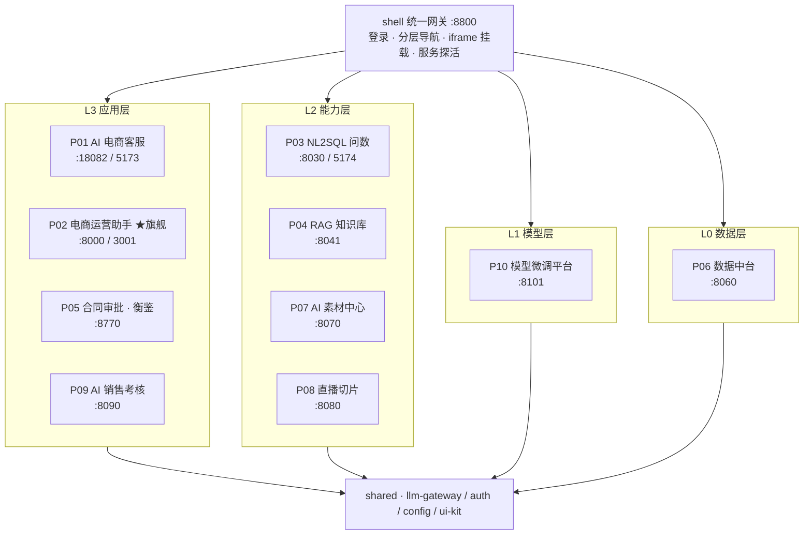
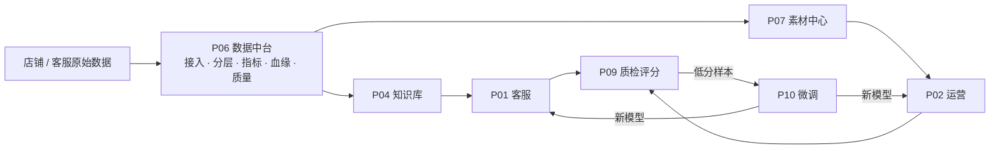

# 云枢智能 · AI 电商运营中台

> 十个 AI 能力模块，**一套统一系统**。
> 底层数据中台统一口径 → 模型层沉淀微调能力 → 能力层提供 RAG / 问数 / 素材 / 切片 → 应用层组装成客服、运营、合同、考核四条业务线，并通过数据回流形成闭环。


面向 **AI 应用开发 / AI-FDE** 岗位的工程作品集。它不是一个「能跑的 demo」，而是把十个独立 demo **合并成一套带认证、带服务注册、带统一设计系统、带跨模块真实调用、带评测与证据的项目**。

本仓库最重要的一条纪律：**任何数字都要能复核**。跑不通就写「未跑通 + 原因」，mock 必须在 **UI 与 README 双处**标注 —— 因此下文每一处指标后面都跟着它的证据文件。

---

## 一、为什么是「一套系统」而不是十个项目

| 统一项 | 落地方式 | 决策记录 |
|---|---|---|
| **入口** | 微前端外壳 `shell/serve.py`（:8800）：登录 + 分层导航 + iframe 挂载，**非单体合并** | [ADR-0001](docs/adr/0001-微前端外壳而非单体合并.md) |
| **认证** | 外壳用 `shared/auth` 签发 HS256 令牌，`postMessage` 下发给模块；P02 保留自身 Cookie RBAC（有意识例外） | [ADR-0003](docs/adr/0003-统一认证与令牌下发.md) |
| **端口** | `shared/config/services.json` = SERVICE_REGISTRY，10 个服务的唯一真源；跨模块调用一律解析于此，**禁止硬编码端口** | [ADR-0002](docs/adr/0002-service-registry-端口单一真源.md) |
| **模型** | 所有 LLM 调用走 `shared/llm-gateway`：主力/备用双端点 + 自动故障转移 + token/耗时统计 + 无 Key 降级 mock | — |
| **取数** | 跨模块取数走**真实 HTTP**：P02 取 P06 指标、P09 取 P01 会话；正常路径 `source=p06-live`，降级路径 `degraded=True` 且**不返回伪造字段** | [ADR-0004](docs/adr/0004-跨模块真实调用与降级不伪造.md) |
| **视觉** | `shared/ui-kit/tokens.css` 单一令牌源（**白底 + 单一品牌蓝**，深色为可选态）；静态模块运行时挂 `/shared`，构建型前端构建期内联 + `cp:theme` 主题桥；公司名与 logo 全站走 `brand.json` 可自定义 | [ADR-0005](docs/adr/0005-设计令牌单一真源与构建期耦合.md) |

## 二、架构



数据流闭环 —— 四条业务线共用同一份口径，低分样本回流到微调层：



## 三、快速开始

```bat
云枢智能 一键启动                              :: 桌面图标，静默零窗口，门户就绪自动开浏览器
start-all.bat                                :: = python _tools\supervisor.py start（带一个进度窗口）
python _tools\supervisor.py status           :: 15 个进程逐个 TCP 实测，不是猜的
python _tools\supervisor.py status --verbose :: 没起来的，顺带打它自己的日志尾部
stop-all.bat                                 :: 桌面「停止服务 / 服务状态」图标等价
```

服务不靠「开十几个黑窗口」：`_tools/supervisor.py` 以分离进程托管 15 个服务（10 个模块 API + 3 个构建型前端 + P01 商城中台 + 外壳网关），日志落 `_runtime/logs/`、PID 落 `_runtime/pids/`，端口全部从 SERVICE_REGISTRY 解析。`--takeover` 可以把手工启动的旧进程接管过来 —— **「代码改了但页面还是老样子」基本都是端口上跑着旧进程**。

托管必须用 `CREATE_NO_WINDOW` 而不是 `DETACHED_PROCESS`：本机 Win11 的「默认终端 = Windows Terminal」会在后者下照样给每个服务接管出一个黑窗口（实测 10 服务 = 11 窗口，见 `_evidence/shell/D20-silent-launch-desktop-app.md`）。桌面图标由 `_tools/make_desktop_app.py` 生成 —— 品牌 logo 出自 `shared/config/brand.json`，exe 用系统自带 `csc.exe` 编译（无额外运行时），仓库搬家或换 Python 版本后重跑一次即可。

> 图标各自做什么、演示账号、15 个端口对照表、排障表、开机自启与换品牌后如何刷新图标 —— 见 [`docs/使用手册-静默启动与桌面应用.md`](docs/使用手册-静默启动与桌面应用.md)。

打开 **<http://127.0.0.1:8800>**（不要 `file://` 打开静态页）。

| 系统 | 账号 | 口令 |
|---|---|---|
| 外壳（全部模块） | `owner` / `ops` / `legal` / `sales` / `admin` | `<用户名>123` |
| P02 运营助手 | `boss@` / `ops@` / `design@` / `cs@` `cloudpivot.com` | `Test123456` |
| P05 合同审批 | `legal` / `applicant` / `admin` | `Legal@2026` / `Apply@2026` / `Admin@2026` |

> 以上均为**本地演示种子账号**，与任何线上系统无关；生产部署必须自设 `CP_AUTH_SECRET`。

侧栏状态点是真探活：`GET /api/services/health` 由网关对各模块端口做 TCP 探测，绿=在监听、灰=未启动；未启动的模块在挂载区直接给出可执行启动命令，而不是一个空白 iframe。

**打开就是作品集首页**：`http://127.0.0.1:8800` 的第一屏不是要登录的后台，而是整屏作品集 —— 四层模块卡（每张带实测指标与 **Mock 边界**）、数据流闭环 + 6 条 ADR、可复核的评测（含 P04 本地/云端 Ragas 对照表）、真实/模拟边界声明。访客不登录就能读完；点「进入演示」才弹登录模态，登录后自动回跳到点进去的那个模块。证据与实测链见 `_evidence/shell/D13-portfolio-home.md`。

**品牌可自定义**：外壳左下角 ⚙ 改公司名 / 英文名 / 副标题、上传 logo（自动缩放）→「保存并全站生效」。写的是 `shared/config/brand.json`（品牌位单一真源），外壳、登录页、页脚与各模块侧栏一起变。

## 四、十个模块

| 层 | 模块 | 入口路由 | API / Web | 核心链路 | 技术要点 |
|---|---|---|---|---|---|
| L3 | P01 AI 电商客服 | `customer-service` | 18082 / 5173 | 提问 → 意图识别 → 知识检索 → 生成回复 → 负面情绪建单转人工 | FastAPI + LangChain + Edge-TTS + MySQL + Vue3 |
| L3 | **P02 电商运营助手 ★** | `ecommerce-ops` | 8000 / 3001 | 登录 → 选店 → 文案生成 → **合规检测拦截** → 广告实验 → 对比数据 | FastAPI + LangGraph + SQLAlchemy / Next.js + React 19 + Tailwind 4 |
| L3 | P05 合同审批（衡鉴） | `contract` | 8770 | 上传 → 条款抽取 → 规则风险打分 → LLM 二阶段语义复核 → 报告 + 审批留痕 | **零第三方依赖**：纯标准库 + `ThreadingHTTPServer` + SQLite |
| L3 | P09 AI 销售考核 | `sales-assessment` | 8090 | 导入会话（可来自 P01）→ 规则评分 → 排行榜 + 个人报告 | FastAPI + 规则引擎 + 人机一致性口径 |
| L2 | P03 NL2SQL 问数 | `research` | 8030 / 5174 | 自然语言 → SQL → 执行 → 图表 → 溯源报告，带只读护栏 | DeepAgents + LangChain + FastAPI + Vue3 |
| L2 | P04 RAG 知识库 | `knowledge` | 8041 | 上传 → 切片 → 检索问答**带引用** → 召回/精确/拒答/忠实度评测 | LangGraph + FastAPI + Milvus + MongoDB + 本地 BGE-M3/BGE-reranker |
| L2 | P07 AI 素材中心 | `asset-center` | 8070 | 上传 → 打标 → 以文搜图 → 与投放效果关联 | FastAPI + SQLite + ECharts |
| L2 | P08 直播切片 | `live-clip` | 8080 | 样例直播 → 分段打点（**每段给出得分构成**）→ 批量队列 + 进度 | FastAPI + Pydantic v2 |
| L1 | P10 模型微调平台 | `finetune` | 8101 | 数据集 → 训练 → 评测 → 模型注册表（**无可调用端点**） | FastAPI + LoRA 生命周期编排 |
| L0 | P06 数据中台 | `data-platform` | 8060 | 接入 → ODS/DWD/DWS/ADS 分层 → 指标口径 → 血缘 → 质量校验 | FastAPI + DuckDB |

P05 是刻意做的**第二条技术路线**：内网客户不希望为了跑一个工具先装 Docker，所以它 `python run.py` 即跑（[ADR-0006](docs/adr/0006-p05-零依赖例外.md)）。P02 走云原生全栈。面试可讲「因地制宜」的取舍。

## 五、可复核的数字

### 测试

各模块在自身 venv 内 `pytest` 实跑结果（逐用例说明见 `_evidence/<模块>/INDEX.md`）：

| 模块 | passed | 采集 | 覆盖的验收门禁 |
|---|---|---|---|
| P01 | 62 | 2026-10-13 | 意图三轨道判定 + **幻觉流程名拦截**、结构化指令反序列化、对话状态机（中断压栈/LIFO 恢复）、澄清话术兜底 |
| P02 | 162 | 2026-10-13 | 四角色 RBAC + 403 矩阵、合规检测、Agent 编排、广告实验确认闸门 |
| P03 | 61 | 2026-10-13 | **只读 SQL 护栏**：DROP/DELETE/多语句/注释绕过/关键字嵌套全拦截，且在执行前拦截（无需连库） |
| P04 | 23 | 2026-10-12 | 本地 reranker + **断崖量纲回归**（全相关不被砍到下限） |
| P05 | 46 | 2026-10-13 | 规则风险判定、版本唯一真源、审批回写 |
| P06 | 44 | 2026-10-13 | 指标口径、血缘、质量校验抓脏数据 |
| P07 | 68 | 2026-10-14 | 打标、以文搜图（带拒答）、素材×投放关联、上传真实宽高与删除连带 |
| P08 | 30 | 2026-10-13 | **打点可解释**（四维得分 + 文本理由 + 同进程确定性）、批量队列 |
| P09 | 41 | 2026-10-14 | 评分规则、排行榜、**P09→P01 跨模块集成 4 例**、真人盲评与 Kappa 口径 5 例 |
| P10 | 28 | 2026-10-14 | 数据集/训练/评测/注册表生命周期 + **不造假端点/上传统计真实测量** 防回归 |
| **合计** | **565** | | |

> 每一行的数字都有对应日志在仓库里可复核：`_evidence/<模块>/pytest-*.log`。
> （此前 `.gitignore` 的全局 `*.log` 把这些日志全部挡在仓库外，2026-10-14 收尾复核时已修。）
> 逐模块取**最新一次**运行结果；P09 旧登记写的「34」与实际日志（30）不符，已按日志纠正。

> 另：P05 自带自检 66/66、P1 独立冒烟 37/37（`_evidence/p05/D4任务卡2-3验收报告-P1复核.md`）。
> P04 那一行取的是 **2026-10-12 归档日志**（`_evidence/p04/full_testsuite_p1.log`）：断崖回归用例会真实加载本地 reranker，本次在开发机复跑时 `torch` 载入权重触发 Windows `access violation` 崩溃，属环境相关项，**未复现即不谎称今日复跑**。

### 评测：P04 RAG 检索质量（36 题评测集，本地重排 vs 云端重排，零降级）

评测集由 1 份企业产品安全手册构建，36 题 / easy 22 · medium 11 · hard 3 / 覆盖 21 个维度，ground_truth 逐条对照源文档、零编造。证据：`_evidence/p04/rag_compare_report.json`。

| Ragas 指标 | Local（BGE-reranker-large，不出网） | Cloud（qwen3.7-text-rerank） |
|---|---|---|
| Faithfulness | 0.9651 | **0.9777** |
| Answer Relevancy | 0.8152 | **0.8178** |
| Context Precision | 0.6810 | **0.9190** |
| Context Recall | 0.8681 | **0.9583** |
| Answer Correctness | 0.6900 | **0.7217** |
| 平均延迟 | 51.37 s | 18.69 s |
| 是否出网 | **否** | 是 |

结论：**私有化不是免费的** —— 量纲缺陷修复后重跑，本地 BGE 的 5 项指标仍全面低于云端 `qwen3.7-text-rerank`（Context Precision 差 23.8 pp），平均延迟慢 2.7 倍；换来的是敏感文档**零出网**。这是能直接拿去谈的取舍，而不是「本地也差不多」。

### 评测：P02 广告法合规检测（36 条用例 / 108 条规则词库）

证据：`_evidence/p02/合规检测评测报告.md`，复算脚本 `_evidence/p02/verify_compliance.py`。

- 高危召回 **18/18 = 100%**（消炎杀菌 + 全国销量第一 + 仅此一次 四类命中，带 span、建议替换词与**法条**）
- 合规文案误报 **0/10 = 0%** · 对抗绕过 **0/6 = 0%**
- 标签 F1 基线 98.2%，补「最X型」规则后复核 36/36
- 容错面：零宽字符、全角空格、形近字（苐/蕞/坠）、符号插入（最-好、顶级\*品质）、序数与否定语境豁免、上下文升权

### 评测：P05 LLM 二阶段语义复核（真实调用）

规则层全量召回 → 模型层剔除误报，保留可解释性。实测 3 条命中：`confirm 2 / need_human 1 / false_positive 0`，其中 `need_human` 那条（违约金上限 30%）模型明确回答「需依赖外部法律标准，无法仅凭原文确定」—— prompt 约束真的生效。证据：`_evidence/p05/verify_llm_review.json`。

### 跨模块真实调用

- **P02 → P06**：`/api/v1/dashboard/overview` 返回 7 项真实指标（GMV / 订单 / 转化率 / 客单价 / 退货率 / UV / PV），`metrics_source=p06-live`；把地址指到死端口则 `degraded=True` 且**响应里不带 metrics 字段**，前端黄标提示。
- **P09 → P01**：真实拉取 P01 MySQL 会话 → 角色映射 `user/bot → customer/agent` → 按 `session_id` 聚合评分（实测 65.5 / 70.5）；不可用时 `imported=0`，不编样本。
- 证据：`_evidence/p02-ecommerce-ops-assistant/cross-module-p06-20261013.md`、`_evidence/p09-ai-sales-assessment/cross-module-p01-20261013.md`。

## 六、真实 / 模拟边界（双处标注）

这是作品集里我最想被追问的部分。**降级一律如实标注，不冒充真实**。

| 模块 | 真实 | 模拟（已在 UI + README 标注） |
|---|---|---|
| P01 | 意图/状态机/校验链（62 单测）、知识检索、转人工建单 | 订单与商品来自随附的**mock 商城中台**（:18081）；端到端链路依赖真实 LLM 端点 + MySQL |
| P02 | 全链路（登录、RBAC、合规、实验、取数） | 无 Key 时网关降级 mock 生成，前端标「演示」 |
| P03 | SQL 护栏、执行链路 | 依赖外部模型 Key；无有效 Key 时**把中文原因推给前端**，不再永远「思考中」 |
| P04 | 入库 / 检索 / 重排 / 评测：Embedding 本地 BGE-M3 + Rerank 本地或云端双后端，全真实 | 「三路召回」中 MCP 联网搜索曾恒 0（`cleanup` 属性错误），已修复并复跑 |
| P05 | 规则风险判定、审批流、报告 | 审批「模拟回写」子系统是**刻意设计**；LLM 二阶段默认 `enabled=false` |
| P06 | DuckDB 分层与指标计算 | 样例数据自动 seed（演示数据集，非真实店铺） |
| P07 | 上传（真实宽高）/ 打标 / 检索带拒答 / 关联报表 | 生图是 **Pillow 程序化规格卡（非 AI 出图）**；检索是文本层 n-gram **而非 CLIP 向量** |
| P08 | 队列与进度、得分构成 | ASR 为模拟文本、评分为规则、**无 ffmpeg 真实出片**（`/health` 里 `mock_boundaries` 自陈） |
| P09 | 会话导入、评分与排行榜 | 评分器是规则引擎（Mock LLM），页面挂「Mock Notice」；**人机一致性 Kappa 尚未出具** —— 原先「AI 分 + 随机噪声」冒充人工分已删除，改由真人盲评（`/label.html`），评满 ≥5 条才出数 |
| P10 | 数据集/训练/评测/注册表 生命周期编排 | **无真实训练**，loss 曲线由公式生成；**没有可调用端点**（部署仅登记状态，`endpoint_url` 返回 null），无测量来源的延迟与统计一律 null |

## 七、两个踩过的坑（比功能更值得讲）

**1）改了输出的量纲，等于改了所有下游 —— D5-01**
本地 BGE 输出 logits（-9.48 ~ +5.05），而断崖截断阈值 `0.5 / 0.25` 是按云端 0~1 分调的；更致命的是 `rel_gap = abs_gap / (abs(score) + 1e-6)`，logits 的正负分界就在 0 附近，分母趋零 → 比值爆炸 → 必然触发。表现为「top-k 恒等于下限 3」，把**正分的相关文档静默砍掉**，并直接污染了上一版对比评测（local 3 条 vs passthrough 5 条 → Context Precision 与 Answer Correctness 给出**相反结论**）。
修复：`_rerank_local()` 加 sigmoid 归一对齐 0~1 + `rel_gap` 分母改全局跨度 + 补**用真实 `NodeRerank` 断言全相关不被砍**的集成测试，然后重跑评测。
教训：`rerank_documents()` 自身完全正确，15 项测试无一触及下游消费方 —— **函数层测了、传输层没测**，改函数的 blast radius 不止函数本身。

**2）「静默降级」是缺陷的隐身衣**
MCP 报错被 `try/except` 吞掉 → 功能死了但流程照跑、日志只有一行 WARNING、端到端照样「通过」。同样地，P05 曾把业务 code 401 映射成 **HTTP 200**（`_http_status` 兜底值错），前端按 `resp.ok` 判断就把失败当成功。
教训：**验证时要看日志里的 WARNING，不能只看「有没有异常、有没有结果」**；自检测函数返回值不等于测传输层。

## 八、工程决策记录

`docs/adr/` 共 6 条，每条都写清「被否决的方案与代价」：

| ADR | 决策 |
|---|---|
| 0001 | 微前端外壳 + iframe 挂载，而非单体合并 |
| 0002 | SERVICE_REGISTRY 作为端口单一真源 |
| 0003 | 统一认证与令牌下发（P02 Cookie 会话为有意识例外） |
| 0004 | 跨模块真实 HTTP 调用，降级路径不伪造数据 |
| 0005 | 设计令牌单一真源 + 两类前端的注入方式与耦合代价 |
| 0006 | P05 零第三方依赖例外 |

## 九、已知限制（当前阶段未闭环）

1. **模型凭据与数据源**：两套阿里云百炼 Key 经实测**均已有效**，P03 问数的模型层已真实接通（2026-10-13 晚）。此前「答不出内容」的根因不是 Key 失效，而是 P03 把仓库根目录算成了 `projects/`、根 `.env` 从未被读到 —— 修复与逐条实测记录见 `_evidence/INDEX.md` 的 D12。仍未闭环的是**数据源**：P03 依赖的 MySQL(3306) / RAGFlow(9380) 未启动、网络搜索仍是 mock Key（已实测到「库里没有的数据会明确拒答而不是编造数字」）。另实测出一条能力边界：**Embedding / Rerank 只有免费额度端点提供，Token Plan 端点返回 `Model not exist`**，因此 P04 的真嵌入不能只靠套餐通道，对外演示建议换按量付费 `sk-` Key。
2. **没有的性能数字就是不写**：全平台**未做并发压测**（无 P95 / 错误率），**未测覆盖率**。P06/P07/P09 的性能描述属 README 声明。
3. **P10 未真实训练**（无 GPU 可用），loss 曲线与前后对比属模拟演示；页面与本 README 双处标注。
4. **P02 浅色态**：`/` → `/login` 跳转会丢 `?cp-theme`，需改 Cookie 供 SSR 读取（尚未做）。
5. `02-flagship/` 为空占位；门户 `01-portfolio/` 是静态页，不依赖后端进程。
6. **没有公网入口**：十个模块全部只监听本机/局域网，**远程访问尚未打通**。工具已就位（`_tools/tunnel.py start/stop/status`，自校验通过才对外发链接），但本机「快车VPN」的 TUN + fake-IP 会对 `argotunnel.com` 做 TLS 中间人，cloudflared 边缘握手直接 `EOF`、访客侧 530。当前可用的只有同 WiFi 的 `http://192.168.1.112:8800`（见 D12）。三条出路与取舍见 `_evidence/shell/D13-portfolio-home.md` 第三节。

## 十、目录与证据

```
├── shell/                 统一网关 :8800（登录 / 导航 / 挂载 / 探活 / 品牌）
├── projects/p01..p10/     十个模块，各自 README 写清「源项目路径 + 改造清单」
├── shared/                llm-gateway · auth · config · ui-kit
├── docs/adr/              6 条技术选型决策记录
├── _tools/                supervisor.py（15 进程托管）· shot.py（无头 Edge + CDP 截图取证）
├── _evidence/             真实跑出来的日志、接口返回、截图、评测报告
│   └── INDEX.md           逐条登记「哪份证据证明哪个功能跑通」
├── 00-总纲/               架构总纲、技术规范、验收门禁、面试讲稿
└── 01-portfolio/          深色作品集门户
```

验收规则：**任何功能声称完成前，必须有一次真实执行的证据落到 `_evidence/` 并在 INDEX 登记**；跑不通就写「未跑通 + 原因」。全平台截图与联调记录见 `_evidence/shell/INDEX.md`（登录 → 智能体矩阵 → 十模块挂载 → 品牌定制），进度全量登记在 `_evidence/INDEX.md`。

> 原始 `*.log` 属本地证据、已在 `.gitignore` 内；仓库里以各模块 `INDEX.md` 与验收报告 `.md` 的登记为准，每份报告都附**可复现的验证脚本**（`verify_*.py`）。

## 十一、怎么用这个项目做面试准备

| 路线 | 看什么 |
|---|---|
| **AI-FDE** | 第四章的「P05 零依赖 vs P02 云原生」取舍、第五章的本地/云端评测对照、第九章的凭据与私有化边界 |
| **AI 应用开发** | `shared/llm-gateway` 故障转移与降级、P04 的 rerank 双后端与断崖截断、P02 的合规检测（法条 + span + 建议替换词） |
| **工程化** | 6 条 ADR、SERVICE_REGISTRY 单一真源、`_evidence/` 证据门禁、第七章两个缺陷的根因分析 |

---

作者：**李奕波** · GitHub [@liyibo0410](https://github.com/liyibo0410) · 求职方向：AI 应用开发 / AI-FDE

> 公司名「云枢智能 / CloudPivot」为作品集业务建模设定；所有指标来自本地实测，未做线上部署宣称。
