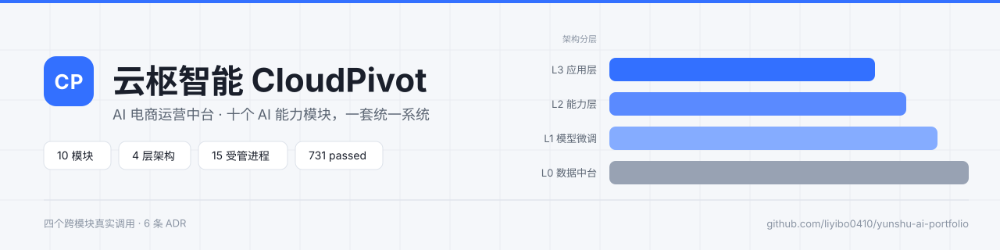
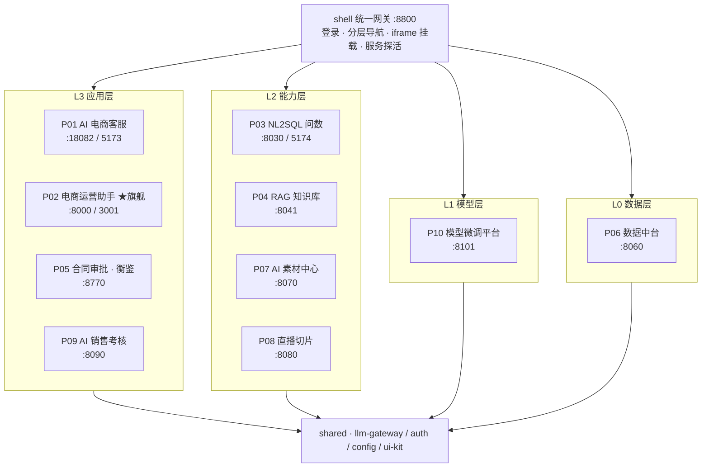
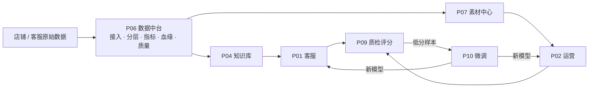
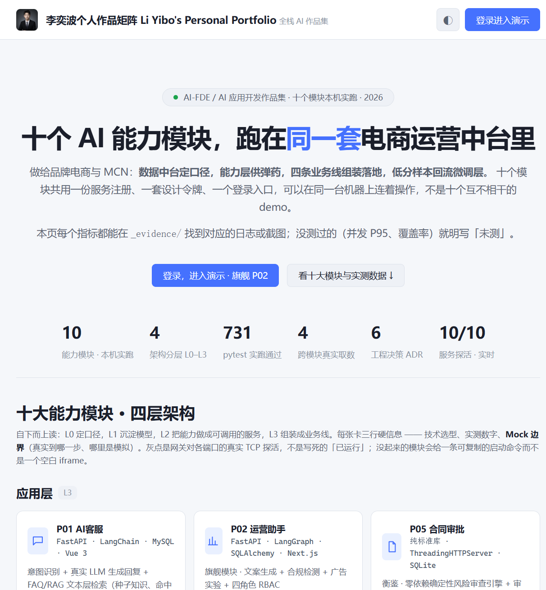
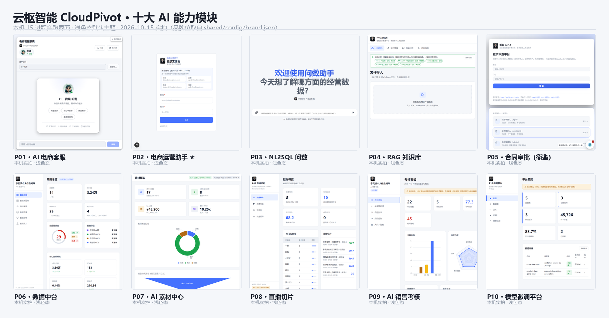

<p align="center">
  <picture>
    <source media="(prefers-color-scheme: dark)" srcset="docs/assets/github/banner-dark.svg">
    
  </picture>
</p>

<p align="center">
  
  
  
  
  
  
  
</p>

<p align="center">
  <a href="#三平台长什么样截图"><b>先看截图</b></a>
  &nbsp;·&nbsp; <a href="#四快速开始"><b>本地跑起来</b></a>
  &nbsp;·&nbsp; <a href="#六可复核的数字"><b>可复核的数字</b></a>
  &nbsp;·&nbsp; <a href="#十二怎么用这个项目准备面试"><b>面试阅读路线</b></a>
  &nbsp;·&nbsp; <a href="_evidence/INDEX.md"><b>证据索引</b></a>
</p>

---

> 十个 AI 能力模块，**一套统一系统**。
> 底层数据中台统一口径 → 模型层沉淀微调能力 → 能力层提供 RAG / 问数 / 素材 / 切片 → 应用层组装成客服、运营、合同、考核四条业务线，并通过数据回流形成闭环。

面向 **AI 应用开发 / AI-FDE** 岗位的工程作品集。它不是一个「能跑的 demo」，而是把十个独立 demo **合并成一套带认证、带服务注册、带统一设计系统、带跨模块真实调用、带评测与证据的项目**。

本仓库最重要的一条纪律：**任何数字都要能复核**。跑不通就写「未跑通 + 原因」，mock 必须在 **UI 与 README 双处**标注 —— 因此下文每一处指标后面都跟着它的证据文件。

## 三十秒速览

| | |
|---|---|
| **是什么** | 十个 AI 能力模块，跑在**同一套**电商运营中台里：一个登录入口、一份服务注册表、一套设计令牌、四条跨模块真实调用链路 |
| **多大规模** | 10 个业务模块 · 4 层架构 · 15 个受管进程 · 6 条 ADR · 731 passed（全平台 pytest 合计） |
| **最硬的一条差异** | 跨模块取数走**真实 HTTP**：正常路径标 `source=p06-live`，降级时**「少返回」而不是「编一个」**（`degraded=True` 且响应里直接不含该字段） |
| **最想被追问的** | 真实 / 模拟边界（[第六章](#七真实与模拟的边界双处标注)）与两个缺陷根因（[第八章](#八两个踩过的坑比功能更值得讲)）—— 未做的就写「未做」 |
| **怎么验** | 每条指标都能在 `_evidence/` 找到日志 / 接口返回 / 截图 / 评测报告；`python _tools\supervisor.py status` 是逐端口 TCP 实测，不是写死的「已运行」 |
| **作者** | 李奕波 · 求职方向 AI-FDE / AI 应用开发 · 全套从需求拆解到进程托管由一人完成 |

## 目录

- [一、为什么是「一套系统」而不是十个项目](#一为什么是一套系统而不是十个项目)
- [二、架构](#二架构)
- [三、平台长什么样（截图）](#三平台长什么样截图)
- [四、快速开始](#四快速开始)
- [五、十个模块](#五十个模块)
- [六、可复核的数字](#六可复核的数字)
- [七、真实与模拟的边界（双处标注）](#七真实与模拟的边界双处标注)
- [八、两个踩过的坑（比功能更值得讲）](#八两个踩过的坑比功能更值得讲)
- [九、工程决策记录](#九工程决策记录)
- [十、已知限制（当前阶段未闭环）](#十已知限制当前阶段未闭环)
- [十一、目录与证据](#十一目录与证据)
- [十二、怎么用这个项目准备面试](#十二怎么用这个项目准备面试)

## 一、为什么是「一套系统」而不是十个项目

| 统一项 | 落地方式 | 决策记录 |
|---|---|---|
| **入口** | 微前端外壳 `shell/serve.py`（:8800）：登录 + 分层导航 + iframe 挂载，**非单体合并** | [ADR-0001](docs/adr/0001-微前端外壳而非单体合并.md) |
| **认证** | 外壳用 `shared/auth` 签发 HS256 令牌，`postMessage` 下发给模块；P02 保留自身 Cookie RBAC（有意识例外） | [ADR-0003](docs/adr/0003-统一认证与令牌下发.md) |
| **端口** | `shared/config/services.json` = SERVICE_REGISTRY，10 个服务的唯一真源；跨模块调用一律解析于此，**禁止硬编码端口** | [ADR-0002](docs/adr/0002-service-registry-端口单一真源.md) |
| **模型** | 所有 LLM 调用走 `shared/llm-gateway`：主力/备用双端点 + 自动故障转移 + token/耗时统计 + 无 Key 降级 mock | — |
| **取数** | 跨模块取数走**真实 HTTP**：P02 取 P06 指标、P09 取 P01 会话；正常路径 `source=p06-live`，降级路径 `degraded=True` 且**不返回伪造字段** | [ADR-0004](docs/adr/0004-跨模块真实调用与降级不伪造.md) |
| **视觉** | `shared/ui-kit/tokens.css` 单一令牌源（**白底 + 单一品牌蓝**，深色为可选态）；静态模块运行时挂 `/shared`，构建型前端构建期内联 + `cp:theme` 主题桥；公司名与 logo 全站走 `brand.json` 可自定义 | [ADR-0005](docs/adr/0005-设计令牌单一真源与构建期耦合.md) |

## 二、架构



数据流闭环 —— 四条业务线共用同一份口径，低分样本回流到微调层：



## 三、平台长什么样（截图）

外壳首页本身就是作品集 —— 访客**不登录**就能整屏读完四层模块卡、数据闭环、6 条 ADR 与真实/模拟边界；点「进入演示」才弹登录模态。首屏的六个数字全部是实跑值（10 模块 · 4 层 · 731 passed · 4 条跨模块真实取数 · 6 条 ADR · 10/10 服务探活）：

<p align="center">
  
</p>

十个模块的真实界面（同一套设计令牌：白底 + 单一品牌蓝；2026-10-15 本机 15 进程在线时实拍）：

<p align="center">
  
</p>

> **截图为本机实拍**，其中好几张正好拍到「诚实标注」本身：P08 左下角是 `ASR / 评分 / 视频 均为模拟`，P09 顶部是「LLM 评分使用基于规则的启发式算法，而非真实 LLM 调用」，P10 顶部是「训练、评测和部署均为模拟，未实际占用 GPU 资源」，P04 顶部是真实依赖探测（Milvus / MongoDB / MinIO / BGE-M3 / LLM 全部在线）。这不是为了好看补的话术，是第一章那条纪律在页面上的样子。

> **图里的品牌名和正文不同，这是有意的**：截图取自本机运行实例，那里 `shared/config/brand.json`（品牌位单一真源，且不入库）已被换成了「李奕波个人作品矩阵」，用的是本人上传的 logo —— 默认值仍是「云枢智能 / CloudPivot」，外壳左下角 ⚙ 改一下全站即刻生效。这本身就是第一章「品牌可自定义」那条的证据。
>
> 逐张大图与说明：`docs/assets/github/screens/p01.png` ~ `p10.png`（本次实拍）与 `_evidence/screenshots/`（历史留档，**注意其中 `pXX.png` 是浅色态改版之前的深色界面**）。截图清单、尺寸、内容与隐私核查见 [`docs/assets/github/SCREENSHOTS.md`](docs/assets/github/SCREENSHOTS.md)。
> 公网演示入口的**实测可达性**（含失败记录）见 [`docs/assets/github/online-demo.md`](docs/assets/github/online-demo.md)。

## 四、快速开始

```bat
云枢智能 一键启动                              :: 桌面图标，静默零窗口，门户就绪自动开浏览器
start-all.bat                                :: = python _tools\supervisor.py start（带一个进度窗口）
python _tools\supervisor.py status           :: 15 个进程逐个 TCP 实测，不是猜的
python _tools\supervisor.py status --verbose :: 没起来的，顺带打它自己的日志尾部
stop-all.bat                                 :: 桌面「停止服务 / 服务状态」图标等价
```

服务不靠「开十几个黑窗口」：`_tools/supervisor.py` 以分离进程托管 15 个服务（10 个模块 API + 3 个构建型前端 + P01 商城中台 + 外壳网关），日志落 `_runtime/logs/`、PID 落 `_runtime/pids/`，端口全部从 SERVICE_REGISTRY 解析。`--takeover` 可以把手工启动的旧进程接管过来 —— **「代码改了但页面还是老样子」基本都是端口上跑着旧进程**。

托管必须用 `CREATE_NO_WINDOW` 而不是 `DETACHED_PROCESS`：本机 Win11 的「默认终端 = Windows Terminal」会在后者下照样给每个服务接管出一个黑窗口（实测 10 服务 = 11 窗口，见 `_evidence/shell/D20-silent-launch-desktop-app.md`）。桌面图标由 `_tools/make_desktop_app.py` 生成 —— 品牌 logo 出自 `shared/config/brand.json`，exe 用系统自带 `csc.exe` 编译（无额外运行时），仓库搬家或换 Python 版本后重跑一次即可。

> 图标各自做什么、演示账号、15 个端口对照表、排障表、开机自启与换品牌后如何刷新图标 —— 见 [`docs/使用手册-静默启动与桌面应用.md`](docs/使用手册-静默启动与桌面应用.md)。

打开 **<http://127.0.0.1:8800>**（不要 `file://` 打开静态页）。

| 系统 | 账号 | 口令 |
|---|---|---|
| 外壳（全部模块） | `owner` / `ops` / `legal` / `sales` / `admin` | `<用户名>123` |
| P02 运营助手 | `boss@` / `ops@` / `design@` / `cs@` `cloudpivot.com` | `Test123456` |
| P05 合同审批 | `legal` / `applicant` / `admin` | `Legal@2026` / `Apply@2026` / `Admin@2026` |

> 以上均为**本地演示种子账号**，与任何线上系统无关；生产部署必须自设 `CP_AUTH_SECRET`。

侧栏状态点是真探活：`GET /api/services/health` 由网关对各模块端口做 TCP 探测，绿=在监听、灰=未启动；未启动的模块在挂载区直接给出可执行启动命令，而不是一个空白 iframe。

**打开就是作品集首页**：`http://127.0.0.1:8800` 的第一屏不是要登录的后台，而是整屏作品集 —— 四层模块卡（每张带实测指标与 **Mock 边界**）、数据流闭环 + 6 条 ADR、可复核的评测（含 P04 本地/云端 Ragas 对照表）、真实/模拟边界声明。访客不登录就能读完；点「进入演示」才弹登录模态，登录后自动回跳到点进去的那个模块。证据与实测链见 `_evidence/shell/D13-portfolio-home.md`。

**品牌可自定义**：外壳左下角 ⚙ 改公司名 / 英文名 / 副标题、上传 logo（自动缩放）→「保存并全站生效」。写的是 `shared/config/brand.json`（品牌位单一真源），外壳、登录页、页脚与各模块侧栏一起变。

## 五、十个模块

| 层 | 模块 | 入口路由 | API / Web | 核心链路 | 技术要点 |
|---|---|---|---|---|---|
| L3 | P01 AI 电商客服 | `customer-service` | 18082 / 5173 | 提问 → 意图三轨道 → FAQ/RAG 文本层检索（命中不足即拒答）→ 生成回复 → `human_handoff` 转人工流程 | FastAPI + LangChain + Edge-TTS + MySQL + Vue3 |
| L3 | **P02 电商运营助手 ★** | `ecommerce-ops` | 8000 / 3001 | 登录 → 选店 → 文案生成 → **合规检测拦截** → 广告实验 → 对比数据 | FastAPI + LangGraph + SQLAlchemy / Next.js + React 19 + Tailwind 4 |
| L3 | P05 合同审批（衡鉴） | `contract` | 8770 | 上传 → 条款抽取 → 规则风险打分 → LLM 二阶段语义复核 → 报告 + 审批留痕 | **零第三方依赖**：纯标准库 + `ThreadingHTTPServer` + SQLite |
| L3 | P09 AI 销售考核 | `sales-assessment` | 8090 | 导入会话（可来自 P01）→ 规则评分 → 排行榜 + 个人报告 | FastAPI + 规则引擎 + 人机一致性口径 |
| L2 | P03 NL2SQL 问数 | `research` | 8030 / 5174 | 自然语言 → SQL → 执行 → 图表 → 溯源报告，带只读护栏 | DeepAgents + LangChain + FastAPI + Vue3 |
| L2 | P04 RAG 知识库 | `knowledge` | 8041 | 上传 → 切片 → 检索问答**带引用** → 召回/精确/拒答/忠实度评测 | LangGraph + FastAPI + Milvus + MongoDB + 本地 BGE-M3/BGE-reranker |
| L2 | P07 AI 素材中心 | `asset-center` | 8070 | 上传 → 打标 → 以文搜图 → 与投放效果关联 | FastAPI + SQLite + ECharts |
| L2 | P08 直播切片 | `live-clip` | 8080 | 样例直播 → 分段打点（**每段给出得分构成**）→ 批量队列 + 进度 | FastAPI + Pydantic v2 |
| L1 | P10 模型微调平台 | `finetune` | 8101 | 数据集 → 训练 → 评测 → 模型注册表（**无可调用端点**） | FastAPI + LoRA 生命周期编排 |
| L0 | P06 数据中台 | `data-platform` | 8060 | 接入 → ODS/DWD/DWS/ADS 分层 → 指标口径 → 血缘 → 质量校验 | FastAPI + DuckDB |

**P01 的边界要单说一句**：`human_handoff` 是**流程**（`flow_config/user_flows.yml` 流程 6），而「**负面情绪自动建单转人工**」这条链**不存在** —— 全仓没有情绪判定，也没有建单代码（`grep -r "sentiment"` 零命中），所以它既不在上图链路里，也不在第七章的「真实」列里。这是我在收尾复核时主动从 README 里划掉的一条宣称。

P05 是刻意做的**第二条技术路线**：内网客户不希望为了跑一个工具先装 Docker，所以它 `python run.py` 即跑（[ADR-0006](docs/adr/0006-p05-零依赖例外.md)）。P02 走云原生全栈。面试可讲「因地制宜」的取舍。

## 六、可复核的数字

### 测试

各模块在自身 venv 内 `pytest` 实跑结果（逐用例说明见 `_evidence/<模块>/INDEX.md`）：

| 模块 | passed | 采集 | 覆盖的验收门禁 |
|---|---|---|---|
| P01 | 73 | 2026-10-14 | 意图三轨道判定 + **幻觉流程名拦截**、结构化指令反序列化、对话状态机（中断压栈/LIFO 恢复）、澄清话术兜底、**FAQ/RAG 文本层检索命中与拒答** |
| P02 | 178 | 2026-10-14 | 四角色 RBAC + 403 矩阵、合规检测、Agent 编排、广告实验确认闸门、**P02→P07 素材推送（跨模块 7 例）** |
| P03 | 137 | 2026-10-14 | **只读 SQL 护栏**：DROP/DELETE/多语句/注释绕过/关键字嵌套全拦截，且在执行前拦截（无需连库） |
| P04 | 59 | 2026-10-14 | 本地 reranker + **断崖量纲回归**（全相关不被砍到下限） |
| P05 | 48 | 2026-10-14 | 规则风险判定、版本唯一真源、审批回写 |
| P06 | 48 | 2026-10-14 | 指标口径、血缘、质量校验抓脏数据 |
| P07 | 68 | 2026-10-14 | 打标、以文搜图（带拒答）、素材×投放关联、上传真实宽高与删除连带 |
| P08 | 30 | 2026-10-13 | **打点可解释**（四维得分 + 文本理由 + 同进程确定性）、批量队列 |
| P09 | 55 | 2026-10-14 | 评分规则、排行榜、P09→P01 集成 4 例、**低分样本导出（回流 P10）**、真人盲评与 Kappa 口径 5 例 |
| P10 | 35 | 2026-10-14 | 数据集/训练/评测/注册表生命周期 + 不造假端点/上传统计真实测量 + **P09 低分样本回流** |
| **合计** | **731** | | |

> 每一行的数字都有对应日志在仓库里可复核：`_evidence/<模块>/pytest-*.log`。
> （此前 `.gitignore` 的全局 `*.log` 把这些日志全部挡在仓库外，2026-10-14 收尾复核时已修。）
> **本表按全平台回归实测重算**：基线是 D24 的 `_evidence/regression-20261014-pytest.log`（当轮 **705 passed / 0 failed**，逐模块 62 / 171 / 137 / 59 / 48 / 48 / 68 / 30 / 51 / 31），
> 再加上 2026-10-14 当晚四个切片的增量 —— P01 62→**73**（`test_knowledge_retrieval.py`）、P02 171→**178**（`test_asset_center_push.py`）、P09 51→**55**、P10 31→**35** —— 得 **731**。
> 每次实跑的时刻与跑法都写在对应日志头部（例如回归日志第 2~4 行写清了「每模块用各自 `.venv`」「P02 套件根在 `api/`」）。**任何一行都能用对应日志逐条复算。**

> 另：P05 自带自检 66/66、P1 独立冒烟 37/37（`_evidence/p05/D4任务卡2-3验收报告-P1复核.md`）。
> P04 的断崖量纲回归用例会真实加载本地 reranker；开发机上曾触发 `torch` 载入权重的 Windows `access violation`
> （`_evidence/p04/pytest-reranker-crash-20261013.log`），属环境相关项，**未复现即不谎称今日复跑**。

> 另有共享层回归：`shared/llm-gateway` **11 passed**（`_evidence/shared/llm-gateway-pytest-20261014.log`）——
> 该组件（多端点故障转移 / 成本统计 / mock 降级）此前**零自动化测试**，本轮补上；网关的「无重试」仍按红线记为未做。

### 评测：P04 RAG 检索质量（36 题评测集，本地重排 vs 云端重排，零降级）

评测集由 1 份企业产品安全手册构建，36 题 / easy 22 · medium 11 · hard 3 / 覆盖 21 个维度，ground_truth 逐条对照源文档、零编造。证据：`_evidence/p04/rag_compare_report.json`。

| Ragas 指标 | Local（BGE-reranker-large，不出网） | Cloud（qwen3.7-text-rerank） |
|---|---|---|
| Faithfulness | 0.9651 | **0.9777** |
| Answer Relevancy | 0.8152 | **0.8178** |
| Context Precision | 0.6810 | **0.9190** |
| Context Recall | 0.8681 | **0.9583** |
| Answer Correctness | 0.6900 | **0.7217** |
| 平均延迟 | 51.37 s | 18.69 s |
| 是否出网 | **否** | 是 |

结论：**私有化不是免费的** —— 量纲缺陷修复后重跑，本地 BGE 的 5 项指标仍全面低于云端 `qwen3.7-text-rerank`（Context Precision 差 23.8 pp），平均延迟慢 2.7 倍；换来的是敏感文档**零出网**。这是能直接拿去谈的取舍，而不是「本地也差不多」。

### 评测：P02 广告法合规检测（36 条用例 / 108 条规则词库）

证据：`_evidence/p02/合规检测评测报告.md`，复算脚本 `_evidence/p02/verify_compliance.py`。

- 高危召回 **18/18 = 100%**（消炎杀菌 + 全国销量第一 + 仅此一次 四类命中，带 span、建议替换词与**法条**）
- 合规文案误报 **0/10 = 0%** · 对抗绕过 **0/6 = 0%**
- 标签 F1 基线 98.2%，补「最X型」规则后复核 36/36
- 容错面：零宽字符、全角空格、形近字（苐/蕞/坠）、符号插入（最-好、顶级\*品质）、序数与否定语境豁免、上下文升权

### 评测：P05 LLM 二阶段语义复核（真实调用）

规则层全量召回 → 模型层剔除误报，保留可解释性。实测 3 条命中：`confirm 2 / need_human 1 / false_positive 0`，其中 `need_human` 那条（违约金上限 30%）模型明确回答「需依赖外部法律标准，无法仅凭原文确定」—— prompt 约束真的生效。证据：`_evidence/p05/verify_llm_review.json`。

### 跨模块真实调用

- **P02 → P06**：`/api/v1/dashboard/overview` 返回 7 项真实指标（GMV / 订单 / 转化率 / 客单价 / 退货率 / UV / PV），`metrics_source=p06-live`；把地址指到死端口则 `degraded=True` 且**响应里不带 metrics 字段**，前端黄标提示。
- **P09 → P01**：真实拉取 P01 MySQL 会话 → 角色映射 `user/bot → customer/agent` → 按 `session_id` 聚合评分（实测 65.5 / 70.5）；不可用时 `imported=0`，不编样本。
- **P02 → P07**：一键把 P02 的生成物通过真实 HTTP `POST /api/v1/ingest` 推到素材中心，P07 落库 `source=ingest:p02-ecommerce-ops` 且可用 `origin_id`（`p02-ga-<id>`）回查；P07 不可达时 `ok=false/degraded=true` 并附原因，不谎称推送成功。
- **P09 → P10**：`GET /api/v1/export/low-score` 导出低分质检会话 → P10 `POST /api/v1/datasets/from-p09` 登记为微调数据集（端点从 SERVICE_REGISTRY 解析、P10 侧零第三方依赖）；实测拉到 22 条、`provenance=p09-export`；P09 不可达时不创建数据集。
- 证据：`_evidence/p02-ecommerce-ops-assistant/cross-module-p06-20261013.md`、`cross-module-p07-20261014.md`、`_evidence/p09-ai-sales-assessment/cross-module-p01-20261013.md`、`_evidence/p10-model-finetune/cross-module-p09-20261014.md`。

## 七、真实与模拟的边界（双处标注）

这是作品集里我最想被追问的部分。**降级一律如实标注，不冒充真实**。

| 模块 | 真实 | 模拟 / 未实现（已在 UI + README 标注） |
|---|---|---|
| P01 | 意图三轨道、对话状态机、校验链（73 单测）、**FAQ/RAG 文本层检索（命中不足即拒答）**、`human_handoff` 转人工流程 | **「负面情绪自动建单」未实现**（全仓无情绪判定与建单代码，已从本 README 划掉）；订单与商品来自随附的 **mock 商城中台**（:18081）；端到端链路依赖真实 LLM 端点 + MySQL |
| P02 | 全链路（登录、RBAC、合规、实验、取数） | 无 Key 时网关降级 mock 生成，前端标「演示」 |
| P03 | SQL 护栏、执行链路 | 依赖外部模型 Key；无有效 Key 时**把中文原因推给前端**，不再永远「思考中」 |
| P04 | 入库 / 检索 / 重排 / 评测：Embedding 本地 BGE-M3 + Rerank 本地或云端双后端，全真实 | 「三路召回」中 MCP 联网搜索曾恒 0（`cleanup` 属性错误），已修复并复跑 |
| P05 | 规则风险判定、审批流、报告 | 审批「模拟回写」子系统是**刻意设计**；LLM 二阶段默认 `enabled=false` |
| P06 | DuckDB 分层与指标计算 | 样例数据自动 seed（演示数据集，非真实店铺） |
| P07 | 上传（真实宽高）/ 打标 / 检索带拒答 / 关联报表 | 生图是 **Pillow 程序化规格卡（非 AI 出图）**；检索是文本层 n-gram **而非 CLIP 向量** |
| P08 | 队列与进度、得分构成 | ASR 为模拟文本、评分为规则、**无 ffmpeg 真实出片**（`/health` 里 `mock_boundaries` 自陈） |
| P09 | 会话导入、评分与排行榜 | 评分器是规则引擎（Mock LLM），页面挂「Mock Notice」；**人机一致性 Kappa 尚未出具** —— 原先「AI 分 + 随机噪声」冒充人工分已删除，改由真人盲评（`/label.html`），评满 ≥5 条才出数 |
| P10 | 数据集/训练/评测/注册表 生命周期编排 | **无真实训练**，loss 曲线由公式生成；**没有可调用端点**（部署仅登记状态，`endpoint_url` 返回 null），无测量来源的延迟与统计一律 null |

## 八、两个踩过的坑（比功能更值得讲）

**1）改了输出的量纲，等于改了所有下游 —— D5-01**
本地 BGE 输出 logits（-9.48 ~ +5.05），而断崖截断阈值 `0.5 / 0.25` 是按云端 0~1 分调的；更致命的是 `rel_gap = abs_gap / (abs(score) + 1e-6)`，logits 的正负分界就在 0 附近，分母趋零 → 比值爆炸 → 必然触发。表现为「top-k 恒等于下限 3」，把**正分的相关文档静默砍掉**，并直接污染了上一版对比评测（local 3 条 vs passthrough 5 条 → Context Precision 与 Answer Correctness 给出**相反结论**）。
修复：`_rerank_local()` 加 sigmoid 归一对齐 0~1 + `rel_gap` 分母改全局跨度 + 补**用真实 `NodeRerank` 断言全相关不被砍**的集成测试，然后重跑评测。
教训：`rerank_documents()` 自身完全正确，15 项测试无一触及下游消费方 —— **函数层测了、传输层没测**，改函数的 blast radius 不止函数本身。

**2）「静默降级」是缺陷的隐身衣**
MCP 报错被 `try/except` 吞掉 → 功能死了但流程照跑、日志只有一行 WARNING、端到端照样「通过」。同样地，P05 曾把业务 code 401 映射成 **HTTP 200**（`_http_status` 兜底值错），前端按 `resp.ok` 判断就把失败当成功。
教训：**验证时要看日志里的 WARNING，不能只看「有没有异常、有没有结果」**；自检测函数返回值不等于测传输层。

## 九、工程决策记录

`docs/adr/` 共 6 条，每条都写清「被否决的方案与代价」：

| ADR | 决策 |
|---|---|
| 0001 | 微前端外壳 + iframe 挂载，而非单体合并 |
| 0002 | SERVICE_REGISTRY 作为端口单一真源 |
| 0003 | 统一认证与令牌下发（P02 Cookie 会话为有意识例外） |
| 0004 | 跨模块真实 HTTP 调用，降级路径不伪造数据 |
| 0005 | 设计令牌单一真源 + 两类前端的注入方式与耦合代价 |
| 0006 | P05 零第三方依赖例外 |

## 十、已知限制（当前阶段未闭环）

1. **模型凭据与数据源**：两套阿里云百炼 Key 经实测**均已有效**，P03 问数的模型层已真实接通（2026-10-13 晚）。此前「答不出内容」的根因不是 Key 失效，而是 P03 把仓库根目录算成了 `projects/`、根 `.env` 从未被读到 —— 修复与逐条实测记录见 `_evidence/INDEX.md` 的 D12。仍未闭环的是**数据源**：P03 依赖的 MySQL(3306) / RAGFlow(9380) 未启动、网络搜索仍是 mock Key（已实测到「库里没有的数据会明确拒答而不是编造数字」）。另实测出一条能力边界：**Embedding / Rerank 只有免费额度端点提供，Token Plan 端点返回 `Model not exist`**，因此 P04 的真嵌入不能只靠套餐通道，对外演示建议换按量付费 `sk-` Key。
2. **没有的性能数字就是不写**：全平台**未做并发压测**（无 P95 / 错误率），**未测覆盖率**。P06/P07/P09 的性能描述属 README 声明。
3. **P10 未真实训练**（无 GPU 可用），loss 曲线与前后对比属模拟演示；页面与本 README 双处标注。
4. **P02 浅色态**：~~`/` → `/login` 跳转会丢 `?cp-theme`，需改 Cookie 供 SSR 读取（尚未做）~~ **已修复（2026-10-14）**：`web/src/app/layout.tsx` 改从 Cookie `cp_theme_v2` 读主题供 SSR，`src/middleware.ts` 在重定向里显式带 `cp-theme`。
5. `02-flagship/` 为空占位；门户 `01-portfolio/` 是静态页，不依赖后端进程。
6. ~~**没有公网入口**~~ **已打通（2026-10-14）**：公网演示走「SSH 反向隧道 + 服务器 nginx 路径分流」——`python _tools/tunnel_remote.py start` 起隧道并自校验，访客入口 `http://39.96.200.45:8070`（shell），模块经 `http://39.96.200.45:8090/pXX/` 挂载。**但它不是常态在线**：2026-10-15 09:40 实测可打开，09:54 同一入口复测已 **502 Bad Gateway**（服务器 nginx 在、上游隧道已断）—— 逐条记录见 `docs/assets/github/online-demo.md`，所以本 README 只写「按需开启、演示时段有限」，不写「现在可用」。设计取舍：① cloudflared Quick Tunnel（`_tools/tunnel.py`）仍可用，但本机代理（FlClash，早先文档里写作「快车VPN」）的 TUN + fake-IP 会对 `argotunnel.com` 做 TLS 中间人，边缘握手 `EOF`、访客侧 530；② 服务器安全组只放通 8070/8090 两个空闲端口，故不回直连各模块端口，而是服务器 nginx 按路径分发到 ssh -R 送上的回环 19000-19010；无前缀路径（vite import 链的 `/src/App.vue`、`/@fs/...`、`/node_modules/.vite/deps/*`，登录跳转的 `/login`、`/console.html`）靠 **cp_mod cookie 路由**——`/pXX/` 入口响应时种 cookie，后续同源请求自动携带，Referer 只作 cookie 缺失时的兜底（vite import 链的 Referer 是上一个模块 URL，单靠 Referer 会漏，2026-10-14 实测教训）；③ 保活由任务计划（CloudPivotDemoTunnel，登录时常驻）托管 python 循环重连，Agent 沙箱回收不到它。**演示结束务必 `python _tools/tunnel_remote.py stop`** —— 演示账号是弱口令且暴露公网。同 WiFi 仍可用 `http://192.168.1.112:8800`（见 D12）。
7. **P01 的知识检索已不再是 stub**（`knowledge/providers.py` 的 `FAQProvider` + `knowledge/seed/faq.json`，73 passed），但**「负面情绪自动建单转人工」整链不存在** —— 第七、五章已按实测改口，不再宣称。同类待补：网络搜索仍在 mock、P09 的 Kappa 需真人评满 ≥5 条。

## 十一、目录与证据

```
├── shell/                 统一网关 :8800（登录 / 导航 / 挂载 / 探活 / 品牌）
├── projects/p01..p10/     十个模块，各自 README 写清「源项目路径 + 改造清单」
├── shared/                llm-gateway · auth · config · ui-kit
├── docs/adr/              6 条技术选型决策记录
├── docs/assets/github/    README 视觉资产（头图 / 社交预览 / 截图墙说明）
├── _tools/                supervisor.py（15 进程托管）· shot.py（无头 Edge + CDP 截图取证）
├── _evidence/             真实跑出来的日志、接口返回、截图、评测报告
│   └── INDEX.md           逐条登记「哪份证据证明哪个功能跑通」
├── 00-总纲/               架构总纲、技术规范、验收门禁、面试讲稿
└── 01-portfolio/          深色作品集门户
```

验收规则：**任何功能声称完成前，必须有一次真实执行的证据落到 `_evidence/` 并在 INDEX 登记**；跑不通就写「未跑通 + 原因」。全平台截图与联调记录见 `_evidence/shell/INDEX.md`（登录 → 智能体矩阵 → 十模块挂载 → 品牌定制），进度全量登记在 `_evidence/INDEX.md`。

> 原始运行日志属本地证据、已在 `.gitignore` 内，但 `_evidence/**/*.log` 已显式开例外入库；仓库里以各模块 `INDEX.md` 与验收报告 `.md` 的登记为准，每份报告都附**可复现的验证脚本**（`verify_*.py`）。

## 十二、怎么用这个项目准备面试

| 路线 | 看什么 |
|---|---|
| **AI-FDE** | 第五章的「P05 零依赖 vs P02 云原生」取舍、第六章的本地/云端评测对照、第十章第 6 条的凭据与私有化边界 |
| **AI 应用开发** | `shared/llm-gateway` 故障转移与降级、P04 的 rerank 双后端与断崖截断、P02 的合规检测（法条 + span + 建议替换词） |
| **工程化** | 6 条 ADR、SERVICE_REGISTRY 单一真源、`_evidence/` 证据门禁、第八章两个缺陷的根因分析 |

---

作者：**李奕波** · GitHub [@liyibo0410](https://github.com/liyibo0410) · 求职方向：AI 应用开发 / AI-FDE

> 公司名「云枢智能 / CloudPivot」为作品集业务建模设定；所有指标来自本地实测，未做线上部署宣称。
> 本 README 的每个数字都能在 `_evidence/` 找到对应文件；**未测量的（并发 P95、覆盖率、Kappa）就写「未测」，不做美化**。