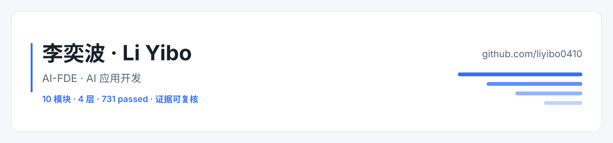

<picture>
  <source media="(prefers-color-scheme: dark)" srcset="./banner-dark.svg">
  <source media="(prefers-color-scheme: light)" srcset="./banner.svg">
  
</picture>

**李奕波（Li Yibo）** ｜ AI-FDE / AI 应用开发

郑州 · 大专（河南建筑职业技术学院）· 1.5 年开发经验 
GitHub [@liyibo0410](https://github.com/liyibo0410) · 邮箱 [2332908627@qq.com](mailto:2332908627@qq.com) · 影刀 RPA 高级工程师 · 英语四级

## 在做什么

- **让十个各自独立的 AI demo 变成一套真的跑在一起的系统。** 数据中台、模型微调、RAG 问数、素材中心、直播切片，加上客服、运营、合同、考核四条业务线，共用同一套登录、同一套设计系统和同一份端口注册表，模块之间用真实 HTTP 互相取数，而不是各自写一份假数据。
- **把「模型能跑通」再往前推一步到「业务敢用」。** 检索要能给出引用出处，Agent 要吐结构化结果，库里没有的数据要明确拒答，降级路径要留痕可观测 —— 这些都是接口和页面上的硬约束，不是文档里的口号。
- **留下的工程痕迹必须能被别人复核。** 每个写出来的数字都对应仓库 `_evidence/` 里的运行日志或截图；跑不通的功能就老老实实写「未跑通 + 原因」，而不是写成「已完成」。

## 我关心的问题

- **多租户 / 多店铺 / 数据合规不是后期补的。** 李奕波个人作品矩阵的设定是同时服务几百家店铺，所以每个模块都要先回答「数据按谁隔离、指标口径由谁定义」，而不是先跑通一条 happy path 再回头补隔离。
- **模型答不出来就要答不出来。** 库里没有的数据明确拒答，检索不到就返回「未检索到」，而不是换一个数据源编一个看起来像答案的东西。
- **可观测优先于好看。** 降级要留痕，探活要真去探测端口，日志要能对得上指标 —— 否则故障会以「测试通过」的形式隐身。

## 精选作品：yunshu-ai-portfolio

> 李奕波个人作品矩阵（Li Yibo's Personal Portfolio）是一套面向品牌电商与 MCN 的「AI 电商运营中台」。公司设定为业务建模虚构，代码是本机真实跑起来的。

- **仓库**：[github.com/liyibo0410/yunshu-ai-portfolio](https://github.com/liyibo0410/yunshu-ai-portfolio)
- **怎么看到界面**：仓库 README 第三节有十模块的实拍截图（2026-10-15 本机 15 进程在线时拍的，不依赖任何在线入口）。想真点一遍就用本机一键启动（仓库 README 第四章，演示账号也在那里）；个人主页这里既不放账号口令，也不放需要作者先起隧道才能打开的临时地址。
- **规模**：10 个业务模块 · 4 层 · 15 个受管进程 · 6 条 ADR · 4 条跨模块真实调用链路 · 全平台 pytest **731 passed**
- **技术**：Python + FastAPI（异步服务与 SSE）、LangChain / LangGraph、Next.js + React 19、Vue 3 + Vite、MySQL / Redis / MongoDB / Milvus / Qdrant / DuckDB

### 四层 · 十模块

- **L0 数据中台** —— P06：统一指标口径，其它模块的取数都从这里来。
- **L1 模型层** —— P10：模型微调平台。
- **L2 能力层** —— P03 NL2SQL 问数 / P04 RAG 知识库 / P07 AI 素材中心 / P08 直播切片。
- **L3 应用层** —— P01 AI 电商客服 / **P02 电商运营助手（旗舰）** / P05 合同审批 / P09 AI 销售考核。

### 演示怎么看

- **最快**：仓库 README 第三节 —— 外壳首屏 + 十个模块的实拍截图（浅色态现行界面，2026-10-15 本机 15 进程在线时拍的）。
- **想真点一遍**：仓库 README 第四章，`start-all.bat` 或桌面「一键启动」，打开 `127.0.0.1:8800`；演示账号同章给出（都是本地种子账号）。
- 首屏就是一份完整作品集说明（四层模块卡、闭环图、ADR 索引、真实 / 模拟边界），**未登录也能整屏读完**；点「进入演示」登录后左侧是分层导航，右侧按模块 iframe 挂载。
- 侧栏每个模块后面的状态点是**真探活**：绿=端口在监听，灰=没启动。没启动的模块不会给你一个空白页，而是把可执行的启动命令写在挂载区。
- 公网入口只有作者按需开启（要演示时先起隧道，用完即停），所以这里不写临时地址 —— 免得你点开是一个 502。

### 合在一起的那部分

十个模块不是十个互不相干的仓库：一个微前端外壳（`:8800`）负责登录、分层导航与 iframe 挂载；端口只在 `shared/config/services.json` 里定义一次，跨模块调用与挂载一律解析于此；`shared/auth` 用 HS256 令牌向下发身份；`shared/ui-kit` 是配色与间距的唯一真源，连后来改造的 P05 也从自带调色改回消费这套令牌。跨模块链路是真实调用（P02→P06 指标、P09→P01 会话、P02→P07 素材、P09→P10 模型），拿不到数据就走降级路径并明说，不伪造结果。这些取舍连同被否掉的方案，都写在 ADR-0001 ~ ADR-0006 里。

六条 ADR 一句话索引：

- **ADR-0001** 微前端外壳（`:8800`）：登录 + 分层导航 + iframe 挂载，而不是把十个项目合并成单体。
- **ADR-0002** `shared/config/services.json`：端口与路由的单一真源，跨模块调用一律解析于此。
- **ADR-0003** `shared/auth`：HS256 令牌由外壳签发、向下下发（P02 保留自身 Cookie RBAC 是有意例外）。
- **ADR-0004** 跨模块真实 HTTP 取数，拿不到就走降级路径并说明，不伪造数据。
- **ADR-0005** `shared/ui-kit/tokens.css`：设计令牌单一真源，连改造进来的老模块也改回消费它。
- **ADR-0006** P05 合同审批：唯一允许零第三方依赖的例外，及其代价。

### 两个真实缺陷（我更愿意讲这两个）

- **重排分数量纲没对齐。** 本地 BGE rerank 输出的是 logits，而我的截断阈值是按 0~1 分调的，`rel_gap` 的分母趋近于零 —— 结果是正相关的文档被静默砍掉，还把这个偏差带进了对比评测。教训：换模型就要重新校准阈值，指标反常先怀疑口径。
- **`try/except` 把错误吞掉了。** MCP 报错被异常处理吃掉后系统「静默降级」，端到端测试照样显示通过。教训：降级必须留痕、必须可观测，否则测试给的是假安全感。

## 其它仓库

- **[customer-service-backend](https://github.com/liyibo0410/customer-service-backend)** —— 电商客服后端的独立版本，主作品集的 P01 模块由它改造而来。
- **[rag-knowledge-base](https://github.com/liyibo0410/rag-knowledge-base)** —— RAG 方向的练手仓库，主作品集 P04 走的是同一条技术路线。
- **[LangChain-demo](https://github.com/liyibo0410/LangChain-demo)** —— LangChain 框架的练手 demo。
- 另有 `LangGraph-demo`、`-BOSS-RAG-` 等框架与检索方向的早期练手仓库。

## 技术栈

上面这些徽章是 shields.io 的静态徽章（第三方服务，图挂了不影响信息）。纯文本兜底，内容与徽章一致：

`RAG 全链路（切分 / 向量化 / 混合检索 / BGE-M3 / 重排 / 引用溯源 / Ragas 评测）`、`Agent 编排（LangChain / LangGraph / ReAct / MCP 工具接入 / Pydantic 结构化输出）`、`Python + FastAPI 异步服务与 SSE`、`Next.js + React 19 + Tailwind 4`、`Vue 3 + Vite`、`MySQL / Redis / MongoDB / Milvus / Qdrant / DuckDB`、`Docker / uv`、`ECharts / Pillow`。

## 工程纪律：没有编造的数字

这一节是我最想被看到的地方 —— **未完成的东西，我写在明面上。**

- 没做过并发压测，所以整个作品集里没有任何 P95、QPS、错误率数字。
- 没测过测试覆盖率，所以我只报通过数（731 passed），不报覆盖率。
- P10 微调平台没有做过真实训练：loss 曲线、前后评测对比都是空的，接口里凡是无法测量的数字一律清空。
- P09「与人工评分的一致性」要等真人盲评满 5 条才出 Kappa，之前的假人工分已经删掉。
- P08 直播切片目前仍是纯内存 mock：没有真实调用 ffmpeg、不产出切片文件，所以不办「端到端出片」这件事。
- 每一条仍然成立的指标，都能在仓库 `_evidence/` 对应目录里找到日志或截图。
- 数字还有单一口径，不是四舍五入来的：全平台 731 passed = 705（基线）+ 四个模块随后补齐（P01 62→73 / P02 171→178 / P09 51→55 / P10 31→35），每一行都能用 `_evidence/<模块>/pytest-*.log` 复算。

我不是在说这些没做完的事情很酷，而是想说：如果一份作品集里每个数字都能被追到日志，那它的含金量比一排漂亮的图表高。

## 阅读路线

- **AI-FDE（怎么做取舍）**：先读 `docs/adr/` 的六条决策记录 —— 为什么是微前端外壳而不是把十个项目合成一个单体、为什么端口必须有单一真源、为什么只有 P05 允许零第三方依赖。这里能看出我做工程取舍的方式。
- **AI 应用开发（完整链路）**：再看 `projects/p03-deep-research`（NL2SQL 问数）与 `projects/p04-rag-knowledge-base`（RAG 知识库），可以看到「切分 → 混合检索 → 重排 → 引用溯源 → Ragas 评测」和「自然语言 → SQL → 结构化输出」两条端到端链路。
- **工程化约束（怎么保证不是 PPT）**：最后看 `_tools/supervisor.py`（进程托管、探活与静默启动）和 `_evidence/`（每条指标的日志与截图），以及一次能跑完的全平台 pytest —— 我想让「跑不通」这件事在这个仓库里藏不住。

## 联系与免责

- 邮箱：[2332908627@qq.com](mailto:2332908627@qq.com)
- GitHub：[@liyibo0410](https://github.com/liyibo0410)
- 主作品集：[yunshu-ai-portfolio](https://github.com/liyibo0410/yunshu-ai-portfolio)（README 第三节有十模块实拍截图）

「李奕波个人作品矩阵 / Li Yibo's Personal Portfolio」是为业务建模虚构的公司设定，模块与业务场景都围绕它设计；所有指标来自本机实测，不代表生产环境性能，也没有任何线上生产部署的宣称。公网演示入口是一台单机验证环境、按需开启，只为跑通流程。如果你更愿意读源码而不是看徽章，那正是我希望的。

<!-- 待你确认（不写进正文）：是否要加手机号？个人主页是公网最显眼的抓取目标，我倾向不放。若你确实要放，建议拆成「区号 / 号段 / 尾号」三段或只做成图片，避免被直接扫走。此注释是唯一提醒处，正文里没有号码。 -->