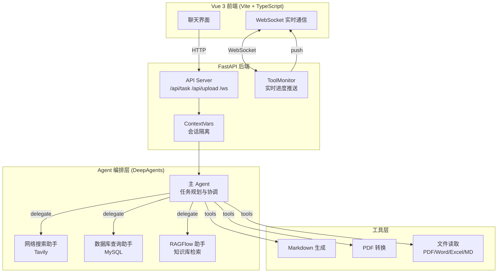

# P03 NL2SQL 问数系统

> **Li Yibo's Personal Portfolio 李奕波个人作品矩阵** | L2 能力层 | 多源数据检索 x Agent 编排 x 流式交互

## 一句话定位

基于 DeepAgents 框架的智能问数系统，支持联网搜索、数据库查询、RAG 知识库检索三路信息融合，通过多 Agent 协作完成任务分解、信息检索与文档生成。

## 来源

- **源项目路径**: `D:\software\PycharmProjects\deep_agent_search\`
- **改造内容**: 复制到 `projects/p03-deep-research/`，补充 `.env.example`、修复 `start.bat` 编码、更新 `pyproject.toml` 命名、重写 README

## 业务痛点

企业运营团队面临三个信息孤岛：
1. **互联网公开信息** -- 行业趋势、竞品动态散落在搜索引擎中
2. **内部结构化数据** -- 商品/库存/销售等业务数据锁在数据库里，非技术人员无法自助查询
3. **内部知识库** -- 产品手册、操作规范等文档沉淀在 RAG 系统中，需要精准检索

传统做法是分别登录不同系统手动拼接信息。本系统通过 **多 Agent 协作**，用户只需用自然语言描述需求，系统自动规划检索路径、跨源融合信息、生成结构化报告。

## 架构



## 技术栈

| 层面 | 技术 | 说明 |
|------|------|------|
| **后端框架** | FastAPI + Uvicorn | 异步 HTTP + WebSocket |
| **Agent 框架** | DeepAgents + LangChain | 多 Agent 编排、工具调用 |
| **LLM** | 通义千问 (OpenAI 兼容接口) | 通过 LangChain init_chat_model 接入 |
| **网络搜索** | Tavily API | 实时互联网信息检索 |
| **数据库** | MySQL + mysql-connector-python | 企业业务数据查询 |
| **RAG** | RAGFlow SDK | 知识库向量检索 |
| **文件处理** | pypdf + python-docx + openpyxl + pandas | 多格式文档解析 |
| **PDF 生成** | markdown + pywin32 (Word COM) | MD -> HTML -> PDF |
| **会话隔离** | ContextVars | 异步安全的协程级上下文 |
| **前端** | Vue 3 + TypeScript + Vite | 深色主题聊天界面 |
| **包管理** | uv (pyproject.toml + uv.lock) | Python 依赖管理 |

## 快速开始

### 前置条件

- Python 3.12+
- Node.js 18+
- uv (Python 包管理)
- MySQL 数据库 (可选，用于数据库查询功能)
- RAGFlow 服务 (可选，用于知识库检索功能)

### 1. 配置环境变量

```bash
cd projects/p03-deep-research
copy .env.example .env
# 编辑 .env 填入真实的 API Key 和数据库连接信息
```

必须配置的项：
- `DASHSCOPE_API_KEY` + `DASHSCOPE_BASE_URL` + `LLM_QWEN_PLUS` -- LLM 接入
- `TAVILY_API_KEY` -- 网络搜索 (无此 Key 则网络搜索功能不可用)
- `RAGFLOW_API_KEY` + `RAGFLOW_BASE_URL` -- RAG 知识库 (可选)
- `MYSQL_*` -- 数据库连接 (可选)

### 2. 安装依赖并启动

**一键启动 (Windows):**

```bash
start.bat
```

**手动启动:**

```bash
# 后端
uv sync
uv run python main.py
# 后端运行在 http://localhost:8030

# 前端 (新终端)
cd ui
npm install
npm run dev
# 前端运行在 http://localhost:5173
```

### 3. 初始化示例数据库 (可选)

```bash
mysql -u root -p < sql/db.sql
```

这将创建 `pharma_db` 数据库，包含药品信息、库存、销售记录三张表及示例数据。

### 4. 访问

打开 http://localhost:5173 进入深度搜索界面。

## 功能清单

| 功能 | 说明 | 状态 |
|------|------|------|
| **多 Agent 协作** | 主 Agent 规划任务，委派给网络搜索/数据库/RAGFlow 三个子 Agent | 已实现 |
| **联网搜索** | Tavily 搜索引擎集成，支持 general/news/finance 分类 | 已实现 |
| **数据库查询** | 自动列出表、预览数据、执行 SQL，支持药品/库存/销售业务数据 | 已实现 |
| **RAG 知识库** | RAGFlow SDK 集成，列出助手、向指定助手提问 | 已实现 |
| **文档生成** | 生成 Markdown 文件，支持转换为 PDF (Word 引擎) | 已实现 |
| **多格式文件读取** | 支持 PDF、Word、Excel、Markdown、纯文本 | 已实现 |
| **文件上传** | 上传文件后 Agent 自动读取分析 | 已实现 |
| **文件下载** | 下载生成的输出文件 | 已实现 |
| **WebSocket 实时通信** | 流式推送 Agent 思考过程、工具调用状态、任务进度 | 已实现 |
| **会话隔离** | ContextVars 实现异步安全的并发会话隔离 | 已实现 |
| **路径安全** | 上传/下载/文件列表接口均有路径遍历防护 | 已实现 |
| **SQL 只读护栏** | `execute_sql_query` 连库前拦截 DROP/DELETE/UPDATE/INSERT 等写操作、多语句、注释注入，仅放行 SELECT/SHOW/DESCRIBE/EXPLAIN/WITH（`tools/sql_guard.py`，61 条 pytest 覆盖） | 已实现 |

## 项目结构

```
p03-deep-research/
├── agent/                      # Agent 编排层
│   ├── main_agent.py           # 主 Agent (任务规划与协调)
│   ├── llm.py                  # LLM 模型初始化
│   ├── load_prompts.py         # Prompt 加载 (YAML)
│   └── sub_agents/             # 子 Agent 定义
│       ├── internet_sub_agent.py  # 网络搜索助手
│       ├── db_sub_agent.py        # 数据库查询助手
│       └── rag_sub_agent.py       # RAGFlow 知识库助手
├── api/                        # API 层
│   ├── server.py               # FastAPI 路由 (HTTP + WebSocket)
│   ├── monitor.py              # ToolMonitor 实时进度推送
│   └── context.py              # ContextVars 会话隔离
├── tools/                      # 工具层
│   ├── internet_search_tool.py # Tavily 网络搜索
│   ├── mysql_tools.py          # MySQL 查询三件套
│   ├── ragflow_tools.py        # RAGFlow 知识库交互
│   ├── markdown_tools.py       # Markdown 文件生成
│   ├── pdf_tools.py            # MD -> PDF 转换
│   └── upload_file_read_tool.py # 多格式文件读取
├── prompt/
│   └── prompts.yml             # Agent Prompt 模板 (与代码分离)
├── utils/                      # 工具函数
│   ├── logger_utils.py         # 彩色日志
│   ├── path_utils.py           # 路径解析与安全校验
│   └── converter_utils.py      # MD -> PDF 转换引擎
├── sql/
│   └── db.sql                  # 示例数据库建表与数据
├── ui/                         # Vue 3 前端
│   ├── src/
│   │   ├── App.vue             # 主组件
│   │   ├── main.ts             # 入口
│   │   └── style.css           # 样式
│   ├── package.json
│   └── vite.config.ts
├── test/                       # 教学 Demo 脚本
├── main.py                     # 入口
├── pyproject.toml              # uv 依赖管理
├── uv.lock                     # 依赖锁定
├── start.bat                   # 一键启动脚本
├── .env.example                # 环境变量模板
└── .gitignore
```

## API 接口

| 方法 | 路径 | 说明 |
|------|------|------|
| POST | `/api/task` | 提交 Agent 任务 (query + thread_id) |
| POST | `/api/upload` | 上传文件 (关联 thread_id) |
| GET | `/api/download?path=` | 下载输出文件 |
| GET | `/api/files?path=` | 列出输出目录文件 |
| WS | `/ws/{thread_id}` | WebSocket 实时通信 |

## 已知限制与 Mock 边界

1. **PDF 转换依赖 Word COM** -- `convert_md_to_pdf` 使用 pywin32 调用 Microsoft Word，仅 Windows 可用且需安装 Word
2. **RAGFlow 依赖外部服务** -- 需要独立部署 RAGFlow 服务，未部署时 RAG 助手功能不可用
3. **Tavily 搜索需要 API Key** -- 无 Key 时网络搜索子 Agent 将报错，但不影响其他功能
4. **数据库功能需要 MySQL** -- 未配置时数据库子 Agent 将报错
5. **前端 UI 为教学版本** -- 当前前端为紫色商务风基础界面，后续计划统一到 Li Yibo's Personal Portfolio 深色主题
6. **自动化测试仅覆盖确定性护栏层** -- `tests/` 下 61 条 pytest 只覆盖 `sql_guard` 只读护栏与工具接入；
   「幻觉拒答」「SQL 自动生成」「图表生成」等由 LLM + deepagents prompt 驱动，非确定性逻辑，
   **未编写自动化评测**，需在真实 LLM 端点下人工验证（见 `_evidence/p03-deep-research/INDEX.md`）
