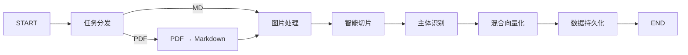

# 🧠 RAG 知识库

<p align="center">
  <strong>企业级智能知识库系统 — 基于 RAG 的文档检索与智能问答平台</strong>
</p>

<p align="center">
  
  
  
  
  
</p>

<p align="center">
  <a href="#-功能特性">功能特性</a> •
  <a href="#-系统架构">系统架构</a> •
  <a href="#-技术栈">技术栈</a> •
  <a href="#-快速开始">快速开始</a> •
  <a href="#-项目结构">项目结构</a> •
  <a href="#-使用示例">使用示例</a>
</p>

---

## 📖 项目简介

RAG 知识库是一个基于 **RAG（检索增强生成）** 技术的企业级智能知识库系统，面向垂直领域（如电子产品手册、维修指南、技术文档等），提供从文档导入、智能解析到精准问答的全链路解决方案。

**核心能力：** 将非结构化的 PDF / Markdown 文档转化为可检索的结构化知识，通过多路召回策略实现高精度检索，并以流式对话方式输出智能回答。

---

## ✨ 功能特性

### 📥 数据导入流水线

| 功能 | 描述 |
|------|------|
| **文档智能解析** | 支持 PDF / Markdown 多格式导入，PDF 通过 MinerU 云端 API 高精度转换为 Markdown |
| **多模态图片理解** | 使用 VLM（视觉语言模型）自动为文档图片生成中文摘要，实现图文语义对齐 |
| **智能文档切片** | 基于句子边界的智能切分，支持重叠策略，保留上下文完整性 |
| **主体识别与标签提取** | 自动识别文档中的商品 / 产品名称，提取关键标签 |
| **混合向量化** | BGE-M3 模型生成稠密向量 + 稀疏向量，双通道存储 |
| **数据持久化** | 向量数据写入 Milvus，原始文件存储至 MinIO |
| **文档增量更新** | 基于 SHA256 文件哈希的增量检测，相同内容自动跳过，避免重复入库 |
| **权限隔离** | 导入时指定 owner 字段，查询自动过滤 `owner == 用户 or owner == public` |

### 🔍 智能检索系统

| 功能 | 描述 |
|------|------|
| **混合向量检索** | 稠密向量（语义匹配）+ 稀疏向量 BM25（关键词匹配）双路融合 |
| **HyDE 检索** | Hypothetical Document Embeddings — 大模型预生成假设答案，提升召回率 |
| **MCP 联网搜索** | 通过 Model Context Protocol 接入实时网络搜索 |
| **RRF 多路融合** | Reciprocal Rank Fusion 算法融合多路召回结果 |
| **智能重排序** | BGE-Reranker 交叉编码器精排 + 断崖检测动态截断 |
| **流式问答** | SSE（Server-Sent Events）实时推送，逐字输出答案 |
| **会话历史管理** | MongoDB 持久化对话历史，支持上下文连续对话 |
| **答案溯源可视化** | 回答附带来源文档片段、chunk_id、相关度评分，支持折叠展开查看原文 |
| **用户反馈闭环** | 👍👎 反馈按钮 + 文字评论，存入 MongoDB `chat_feedback` 集合，支持后续分析优化 |
| **多轮追问优化** | 自动识别追问意图（如"怎么说""什么意思"），复用上一轮主体，跳过重复提取 |

---

## 🏗️ 系统架构

```
┌─────────────────────────────────────────────────────────┐
│                    前端展示层                              │
│            HTML5 + JavaScript + SSE 流式渲染              │
├─────────────────────────────────────────────────────────┤
│                  API 与编排层                              │
│         FastAPI (HTTP)  +  LangGraph (状态图编排)          │
├─────────────────────────────────────────────────────────┤
│                   AI 能力层                               │
│   Qwen 系列大模型 (文本理解/图片总结)  +  BGE 系列 (嵌入/重排) │
├─────────────────────────────────────────────────────────┤
│                   数据存储层                              │
│      Milvus (向量检索)  |  MongoDB (对话历史+反馈)  |  MinIO (文件) │
└─────────────────────────────────────────────────────────┘
```

### 数据导入流程



---

## 🛠️ 技术栈

| 类别 | 技术 | 说明 |
|------|------|------|
| **后端框架** | [FastAPI](https://fastapi.tiangolo.com/) + [Uvicorn](https://www.uvicorn.org/) | 异步高性能 HTTP 服务 |
| **工作流引擎** | [LangGraph](https://langchain-ai.github.io/langgraph/) | 有状态图编排框架 |
| **LLM 框架** | [LangChain](https://python.langchain.com/) | 统一 LLM 调用接口 |
| **大语言模型** | [阿里云百炼 Token Plan](https://bailian.console.aliyun.com/) (Qwen) | qwen3.7-plus / qwen3-vl-flash |
| **向量嵌入** | [BGE-M3](https://huggingface.co/BAAI/bge-m3) + OpenAI API | 1024维稠密 + 稀疏向量 |
| **重排序模型** | [BGE-Reranker-Large](https://huggingface.co/BAAI/bge-reranker-large) | 交叉编码器精排 |
| **向量数据库** | [Milvus](https://milvus.io/) 2.5.5 | 混合检索（稠密+稀疏） |
| **文档数据库** | [MongoDB](https://www.mongodb.com/) | 对话历史 + 用户反馈持久化 |
| **对象存储** | [MinIO](https://min.io/) | 文件与图片存储 |
| **PDF 解析** | [MinerU](https://github.com/opendatalab/MinerU) | 支持公式、表格等复杂排版 |
| **Python 环境** | [uv](https://github.com/astral-sh/uv) | 极速依赖管理 |

---

## 🚀 快速开始

### 前置条件

- Python 3.11+
- Docker & Docker Compose
- 阿里云百炼 Token Plan API Key（[申请地址](https://bailian.console.aliyun.com/)）
- MinerU API Token（[申请地址](https://mineru.net/apiManage/token)）

### 1. 克隆项目

```bash
git clone https://github.com/liyibo0410/-BOSS-RAG-.git
cd -BOSS-RAG-
```

### 2. 部署中间件

项目已内置 `docker-compose.yml`，一条命令即可拉起 Milvus（含 etcd + MinIO）与 MongoDB：

```bash
# Windows：直接双击 start-middleware.bat 即可（脚本会自动识别 compose 命令形态）

# 命令行方式：
docker-compose up -d          # Compose v1（独立命令）
# 或
docker compose up -d          # Compose v2（Docker 插件）

docker-compose ps             # 查看状态
docker-compose down           # 停止（数据保留在 ./volumes/）
```

> 注意：部分机器只安装了 `docker-compose`（v1），此时 `docker compose` 会报
> `unknown command`。`start-middleware.bat` 已自动处理该差异。

### 3. 配置环境变量

```bash
# 复制配置模板
cp .env.example .env

# 编辑 .env 文件，填入你的 API Key 和服务地址
```

关键配置项：

```ini
# LLM API（阿里云百炼 Token Plan）
OPENAI_API_KEY=sk-your-token-plan-api-key
OPENAI_API_BASE=https://token-plan.cn-beijing.maas.aliyuncs.com/compatible-mode/v1
LLM_DEFAULT_MODEL=qwen3.7-plus

# MinerU
MINERU_API_TOKEN=your-mineru-token
MINERU_BASE_URL=https://mineru.net/api/v4

# 数据库连接
MILVUS_URL=http://localhost:19530
MONGO_URL=mongodb://localhost:27017
MINIO_ENDPOINT=localhost:9000
```

### 4. 创建 Python 虚拟环境

```bash
# 使用 uv 创建环境并安装依赖
uv python install 3.11
uv sync
```

### 5. 启动服务（合并后台）

**端口以仓库根 `shared/config/services.json` 为准：p04 = 8041**（`api_port == web_port`）。
`console_service.py` 的 `__main__` 里写的是 8100，那是历史遗留默认值，
按平台方式启动时必须显式指定端口，否则外壳挂不上：

```bash
# 推荐：由全平台托管器拉起（端口自动从 SERVICE_REGISTRY 解析）
python ..\..\_tools\supervisor.py start p04

# 或手工
.venv\Scripts\python.exe -m uvicorn web.api.console_service:app --host 0.0.0.0 --port 8041
```

统一控制台地址：`http://localhost:8041/console.html`
（四 Tab：上传导入 / 文档管理 / 检索问答 / 数据看板；支持 `?tab=docs` 之类深链直达）

> 合并后台说明：`web/api/console_service.py` 通过 `include_router` 复用 `import_service` / `query_service` 的全部业务路由，业务逻辑零改动；另新增 2 个只读接口供「文档管理」Tab 使用：
> - `GET /api/import/tasks`：导入任务列表（状态概览，按创建时间倒序）
> - `GET /api/import/documents`：已入库文档列表（仅 completed 状态）

**兼容旧入口**（路由已挂载到统一后台，亦可独立启动）：

```bash
# 旧入口：导入服务（端口 8000）
uvicorn web.api.import_service:app --port 8000

# 旧入口：查询服务（端口 8001）
uvicorn web.api.query_service:app --port 8001

# 旧页面入口
#   导入页：http://localhost:8000/import.html
#   问答页：http://localhost:8001/chat.html
```

---

## 📁 项目结构

```
knowledge/
├── web/                              # Web 服务层
│   ├── api/                          #   API 路由层
│   │   ├── console_service.py        #     统一控制台服务（端口8100，挂载导入+查询路由，新增只读接口）
│   │   ├── import_service.py         #     导入服务 (POST /upload, GET /status)
│   │   └── query_service.py          #     查询服务 (POST /query, GET /stream, GET /history, POST /feedback)
│   └── page/                         #   前端页面
│       ├── console.html              #     统一控制台（三Tab：上传导入 / 文档管理 / 检索问答）
│       ├── chat.html                 #     聊天界面
│       └── import.html               #     导入界面
│
├── processor/                        # LangGraph 工作流
│   ├── import_processor/             #   📥 导入流程
│   │   ├── main_graph.py             #     主图定义
│   │   ├── state.py                  #     状态类型 (TypedDict)
│   │   ├── base.py                   #     节点基类 (ABC)
│   │   └── nodes/                    #     处理节点
│   │       ├── node_entry.py         #       任务分发
│   │       ├── node_pdf_to_md.py     #       PDF → Markdown
│   │       ├── node_md_img.py        #       多模态图片理解
│   │       ├── node_document_split.py#       智能文档切片
│   │       ├── node_item_name_recognition.py # 主体识别
│   │       ├── node_bge_embedding.py #       混合向量化
│   │       └── node_import_milvus.py #       数据持久化
│   │
│   └── query_processor/              #   🔍 查询流程
│       ├── main_graph.py             #     主图定义（LangGraph 状态图编排）
│       ├── state.py                  #     状态类型 (TypedDict)
│       ├── base.py                   #     节点基类 (ABC)
│       └── nodes/                    #     处理节点
│           ├── node_item_name_confirm.py     #       商品主体确认（意图识别/反问）
│           ├── node_search_embedding.py      #       BGE-M3 稠密+稀疏混合向量检索
│           ├── node_search_embedding_hyde.py #       HyDE 假设文档检索
│           ├── node_web_search_mcp.py        #       MCP 联网搜索
│           ├── node_rrf.py                   #       RRF 多路融合
│           ├── node_rerank.py                #       BGE-Reranker 精排 + 断崖检测
│           └── node_answer_output.py         #       答案生成
│
├── config/                           # 配置管理
├── utils/                            # 工具函数库
│   ├── milvus_utils.py               #   Milvus 操作
│   ├── embedding_utils.py            #   向量嵌入
│   ├── llm_utils.py                  #   LLM 封装
│   ├── reranker_utils.py             #   重排序
│   ├── mongo_history_utils.py        #   历史记录
│   ├── sse_utils.py                  #   SSE 流式推送
│   └── minio_utils.py                #   MinIO 操作
│
├── schema/                           # Pydantic 数据模型
├── services/                         # 业务服务层
├── eval/                             # 检索效果评估（Ragas）
├── docker-compose.yml                # 中间件编排（Milvus + MinIO + MongoDB）
├── start-middleware.bat              # 一键启动中间件（Windows）
├── check_env.py                      # 环境连通性自检脚本

├── .env                              # 环境配置（不提交 Git）
├── .env.example                      # 配置模板
├── pyproject.toml                    # 依赖声明
└── uv.lock                           # 依赖锁定
```

---

## 💡 使用示例

### 导入文档

```bash
# 公开文档（所有人可检索）
curl -X POST http://localhost:8041/upload \
  -F "file=@product_manual.pdf"

# 私有文档（仅指定 owner 可检索）
curl -X POST http://localhost:8041/upload \
  -F "file=@internal_doc.pdf" \
  -F "owner=department_a"
```

### 智能问答

```bash
# 非流式：一次返回 answer + sources（整条链路实测约 35s，控制台默认走流式）
curl -X POST http://localhost:8041/query \
  -H "Content-Type: application/json" \
  -d '{"query": "HAK180 烫金机有哪些安全注意事项", "session_id": "user_001", "is_stream": false}'
```

### 流式获取答案

```bash
# 1) 发起：is_stream=true 立即返回 session_id，流程图在后台线程跑
curl -X POST http://localhost:8041/query \
  -H "Content-Type: application/json" \
  -d '{"query": "HAK180 烫金机有哪些安全注意事项", "session_id": "user_001", "is_stream": true}'

# 2) 订阅 SSE：ready → progress（阶段进度）→ delta（逐字）→ final（完整答案 + sources 引用）
curl -N http://localhost:8041/stream/user_001
```

### 用户反馈

```bash
# 提交反馈（👍 或 👎）
curl -X POST http://localhost:8041/feedback \
  -H "Content-Type: application/json" \
  -d '{"session_id": "user_001", "message_id": "msg_001", "feedback": "up", "comment": "回答很准确"}'
```

### 文档删除（级联清理向量）

```bash
# 列表带真实 chunk_count（按向量库实测回读，历史遗留的 0 会在读取时自愈）
curl "http://localhost:8041/documents?owner=public&limit=50"

# 删除顺序：先按 file_title 清 Milvus 的 kb_chunks / kb_item_names，最后才删 Mongo 记录。
# 反了会怎样：Mongo 先删就再也查不到 file_title，向量变成永远清理不掉的孤儿，
# 表现为「删掉的文档仍会被检索问答命中」。原始文件与 MinIO 对象保留（留出误删恢复余地）。
curl -X DELETE http://localhost:8041/documents/<task_id>

# 统计口径与列表一致（默认 owner=public），否则页头计数会与表格行数对不上
curl "http://localhost:8041/statistics?owner=public"
```

### 统一控制台（四 Tab）

```bash
# 上传导入 / 文档管理 / 检索问答 / 数据看板；支持 ?tab=upload|docs|qa|dashboard 直达
http://localhost:8041/console.html

# 只读接口：导入任务列表（内存态，服务重启后清空 —— 文档本身在「文档管理」里，不受影响）
curl http://localhost:8041/api/import/tasks

# 只读接口：已完成导入的文档列表
curl http://localhost:8041/api/import/documents
```

---

## 📊 检索效果评估（Ragas）

使用 [Ragas](https://github.com/explodinggradients/ragas) 对检索链路与生成质量进行离线评估，脚本见 `eval/eval.py`，测试集 `eval/qa.csv`，结果 `eval/qa_result.csv`（5 项指标：Faithfulness / Answer Relevancy / Context Precision / Context Recall / Answer Correctness）。

**下面这组数字是 3 条样本那一版跑出来的**（`eval/qa_result.csv` 里实际只有 3 行，采集于 2026-10-12 12:51；
测试集后来扩到 36 条，但 `eval.py` 这条单后端链路**没有在 36 条上重跑**）：

| 指标 | 得分（均值，n=3） | 说明 |
|------|------|------|
| Context Recall | 1.0000 | 上下文召回率：所有问题均召回到全部相关证据 |
| Answer Relevancy | 0.9576 | 答案与问题的相关性 |
| Context Precision | 0.7776 | 上下文精确率：召回的切片中相关切片占比 |
| Faithfulness | 0.7111 | 事实忠实度：答案与上下文一致性 |
| Answer Correctness | 0.6196 | 答案与标准答案的综合正确性 |

> 3 条样本不构成任何"水位"结论，只能证明这条评测链路跑得通。
> 当前有效的对比结论看下一节（36 条）。
>
> 🔴 **门禁尚未满足的两项**（`.qoder/rules/04-验收门禁.md` P04 行要求"召回率/精确率/拒答率/忠实度"四指标
> + 一次策略对比实验）：
> ① **拒答率从未被计算** —— `eval/eval.py` 与 `eval/eval_compare.py` 里没有拒答相关逻辑，评测集也没有
> 库外问题，全仓 grep「拒答/refusal」在这两个脚本内零命中；
> ② **父子分块 vs 定长分块的策略对比实验没做过** —— 分块长度只有一种配置
> （`processor/import_processor/config_base.py`），没有可切换的分块策略开关。

### Local vs Cloud 重排对比评测

脚本 `eval/eval_compare.py` 对同一份 `eval/qa.csv` 测试集（**现为 36 条**，原始 3 条保留在 `eval/qa_original_3.csv`），
分别用 local（BGE-reranker-large）和 cloud（DashScope `qwen3.7-text-rerank`）两种重排后端跑完整 RAG 流程，
收集答案与上下文后统一用 Ragas 评估，输出对比报告。

```bash
cd projects/p04-rag-knowledge-base
uv run python eval/eval_compare.py
```

**实测结果**（`_evidence/p04/rag_compare_report.json`，2026-10-12 22:08，36 条 × 2 后端 = 72 次请求，
两侧 `actual_backend` 均为真实后端、`degrade_notes` 为空）：

| 指标 | Local (BGE-reranker-large) | Cloud (DashScope) | 差异 |
|------|------|------|------|
| Faithfulness | 0.9651 | **0.9777** | Cloud +1.3pp |
| Answer Relevancy | 0.8152 | **0.8178** | 持平 |
| Context Precision | 0.6810 | **0.9190** | Cloud +23.8pp |
| Context Recall | 0.8681 | **0.9583** | Cloud +9.0pp |
| Answer Correctness | 0.6900 | **0.7217** | Cloud +3.2pp |
| 平均延迟 | 51.37s | **18.69s** | Cloud 快 2.75× |
| 是否出网 | **否（私有化）** | 是 | Local 唯一保留优势 |

> **结论**：Cloud 端点用 `sk-ws-` 免费工作空间 Key、重排真正生效后，**五项指标全部优于 Local，延迟只有本地的
> 1/2.75**；Local 的卖点是**全链路不出网**，不是质量更好。
> 早期那版"Local 略优"来自 3 条样本 + Cloud 因 `sk-sp-` 不支持 TextReRank 而降级成 passthrough 的基线，
> 已归档在 `_evidence/p04/_archive_D5-01_baseline/`，不能当结论对外讲。

输出文件（保存到 `_evidence/p04/`）：
- `rag_compare_result_local.csv` — local 后端逐条结果
- `rag_compare_result_cloud.csv` — cloud 后端逐条结果
- `rag_compare_report.json` — 汇总对比报告（含各指标均分、平均延迟、降级说明）
- `rag_compare_latency.csv` — 72 条请求的逐条延迟与实际后端记录


---

## 🔑 核心设计模式

| 模式 | 应用位置 | 说明 |
|------|---------|------|
| **模板方法** | `BaseNode.__call__` + `process` | 父类定骨架，子类填逻辑 |
| **单例模式** | `get_config()` | 全局唯一配置对象，避免重复创建 |
| **策略路由** | `route_after_entry()` | 根据文件类型动态选择处理分支 |
| **滑动窗口限流** | `_apply_api_rate_limit()` | 保护 API 调用频率，防止触发限流 |
| **异步轮询** | MinerU PDF 解析 | 长任务异步处理，固定间隔检查状态 |
| **多层兜底** | LLM 调用链路 | 每层 LLM 调用均设 fallback，任一环节失败不中断全流程 |
| **SHA256 去重** | `node_entry.py` | 文件哈希比对实现增量更新，相同文档自动跳过 |

---

## 📊 适用场景

- 📘 **产品手册问答** — 电子产品使用说明、维修手册
- 📄 **技术文档检索** — API 文档、开发指南、FAQ
- 🏢 **企业知识库** — 内部制度、操作规范、培训资料
- 🎧 **售后客服支持** — 产品故障排查、使用指导

---

## ⚠️ 已知限制与 mock 边界

以下是**当前真实状态**，不是"待优化"，演示时按这个口径讲：

| 项 | 真实情况 | 影响 |
|---|---|---|
| **原始文件未进 MinIO** | `run_graph_task` 里 MinIO 上传被显式跳过（本机代理会让 MinIO 写操作挂起），文件只落在 `DATA_BASED_ROOT_DIR/<日期>/<task_id>/` | 对象存储这条链路是**缺的**，README 架构图里的 MinIO 持久化目前仅用于图片资产；换机迁移要拷本地目录 |
| 切片内图片 URL | 指向 `http://localhost:9000/knowledge-base/...`（MinIO 本机地址） | 换端口/远程访问时回答里的图片显示不出来 |
| 「全部导入任务」表 | 数据源是进程内存（`utils/task_utils`），**服务重启即清空** | 只影响任务视图；已入库文档在「文档管理」，来自 MongoDB，不受重启影响 |
| 文档删除的边界 | 级联删的是 Milvus 向量 + MongoDB 记录；**服务器原始文件与 MinIO 对象保留** | 误删可从磁盘重导；磁盘不会因删除而回收 |
| 同名文档 | 向量按 `file_title`（文件名去扩展名）归属，同名文档共享切片 | 删其一会连带清掉另一个的向量，控制台已就地标黄提示 |
| 统计口径 | `/statistics` 默认 `owner=public`，与文档列表一致；库里另有 1 条历史 `owner=test` 记录不计入 | 想看全库需显式传 `owner` 或改查询 |
| MCP 联网搜索 | 真实 MCP 客户端，但端点握手失败时**降级跳过**（只记 warning，不伪造搜索结果） | 断网/端点异常时回答只来自本地知识库 |
| 非流式 `/query` | 整条链路实测约 35s，且会占用一个工作线程；控制台与 chat 页默认走 SSE 流式 | 脚本压测别用非流式 |
| Ragas 评测集 | 对比实验用 **36 条**（`eval/qa.csv`，原始 3 条存于 `eval/qa_original_3.csv`）；但 `eval.py` 单后端那份 `qa_result.csv` **仍只有 3 行未重跑** | 36 条的结论见「Local vs Cloud 重排对比评测」；3 条的数字不构成水位，也不代表线上表现 |
| 拒答率 | **未实现**：`eval/eval.py` 与 `eval/eval_compare.py` 都不计算拒答率，评测集里也没有库外问题 | 门禁要求的四项指标之一，目前只有召回/精确/忠实度三项真跑过 |
| 分块策略 | 只有定长分块一种配置，**没有父子分块开关** | 门禁要求的「父子分块 vs 定长」策略对比实验没做过，不声称做过 |

---

## 📝 开发计划

- [x] 数据导入流水线（PDF / Markdown 解析 → 向量化入库）
- [x] 多模态图片理解与摘要生成
- [x] 混合向量检索 + HyDE + MCP 联网搜索
- [x] RRF 多路融合 + Rerank 重排序
- [x] SSE 流式问答 + 会话历史管理
- [x] 答案溯源可视化（来源文档片段 + 相关度评分）
- [x] 用户反馈闭环（👍👎 + 文字评论 → MongoDB）
- [x] 多轮追问意图识别（复用上一轮主体，跳过重复提取）
- [x] 文档增量更新（SHA256 哈希去重，避免重复入库）
- [x] 基于 owner 的权限隔离（查询自动过滤私有/公开文档）
- [ ] 知识图谱增强检索
- [ ] 前端 UI 优化

---

## 📜 License

MIT License

---

<p align="center">
  <sub>Made with ❤️ by 云枢智能 CloudPivot</sub>
</p>

---

> 本内容由 Coze AI 生成，请遵循相关法律法规及《人工智能生成合成内容标识办法》使用与传播。
