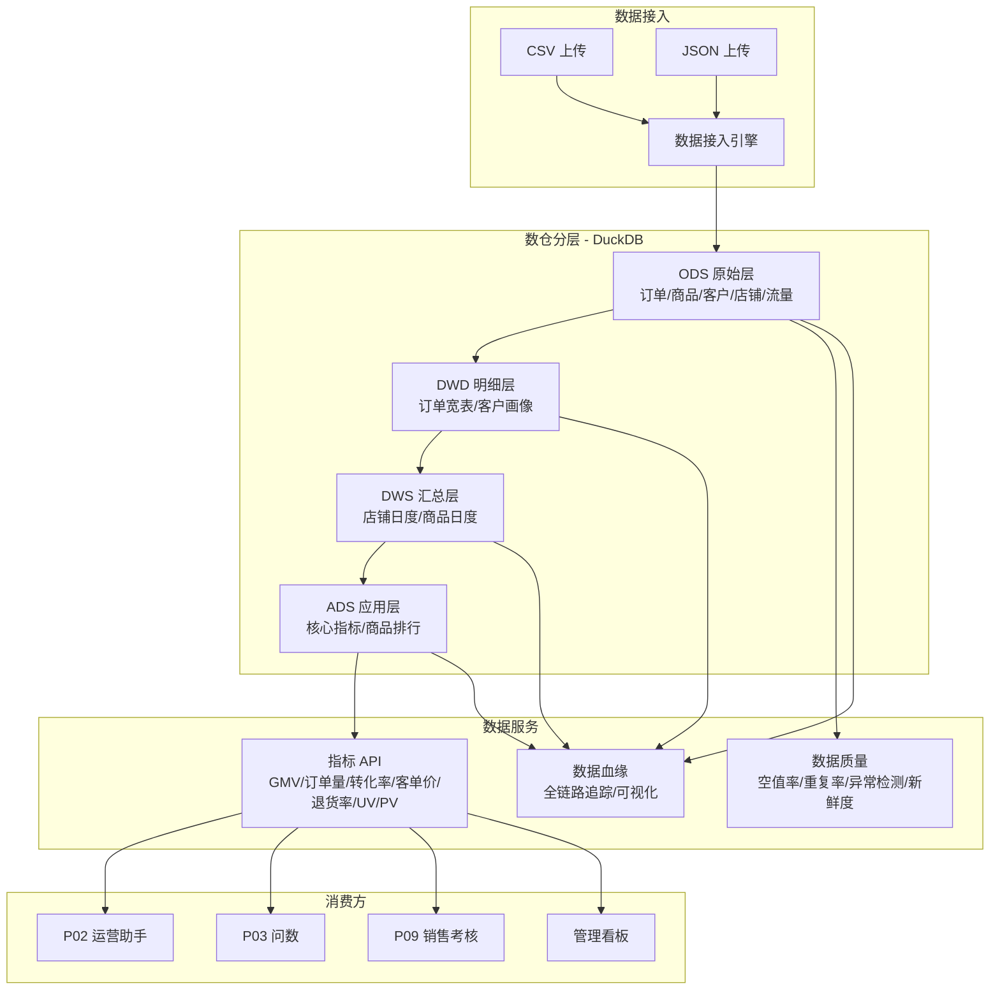

# P06 数据中台 (Data Platform)

> **一句话定位**：云枢智能电商数据中台 —— 统一数据接入、OLAP 分析、指标服务、质量监控与血缘追踪的一站式数据基础设施。

## 业务痛点

1. 多店铺、多渠道数据散落各处，口径不统一，无法横向对比
2. 业务指标（GMV、转化率、退货率等）取数依赖人工 SQL，效率低且易出错
3. 数据质量问题（空值、重复、异常值）缺乏系统化监控
4. 数据从原始层到应用层的流转链路不透明，排查问题困难

## 架构图



## 技术栈

| 组件 | 选型 | 理由 |
|---|---|---|
| Web 框架 | FastAPI | 异步高性能，自动 OpenAPI 文档 |
| 分析引擎 | DuckDB | 嵌入式 OLAP，零部署，列式存储，SQL 兼容 |
| 元数据存储 | SQLite + SQLAlchemy | 轻量级，无需额外服务 |
| 包管理 | uv + pyproject.toml | 快速、确定性构建 |
| 前端 | 单页 HTML + ECharts | 零构建，深色主题，开箱即用 |
| 数据质量 | 自研规则引擎 | 空值率/重复率/主键唯一/值域/新鲜度 |
| 血缘追踪 | 有向图模型 | 自动从 ETL 链路生成，支持可视化 |

## 快速开始

### 一键启动

```bash
# Windows
start.bat

# 或手动启动
cd projects/p06-data-platform
uv sync
uv run python -m app.main
```

服务启动后访问 **http://localhost:8060**

### 首次启动说明

首次启动会自动：
1. 初始化 SQLite 元数据库
2. 生成 3 个月的电商模拟数据（约 35,000+ 订单）
3. 构建 ODS → DWD → DWS → ADS 四层数仓
4. 注册数据血缘关系
5. 同步表元数据

## 数仓分层

| 层级 | 表名 | 说明 |
|---|---|---|
| **ODS** | `ods_orders` | 原始订单表（~35K 行） |
| **ODS** | `ods_products` | 商品主数据（12 SKU） |
| **ODS** | `ods_customers` | 客户主数据（2000 人） |
| **ODS** | `ods_stores` | 店铺主数据（5 店） |
| **ODS** | `ods_traffic` | 流量日志（按店铺/渠道/日） |
| **DWD** | `dwd_order_detail` | 订单明细宽表 |
| **DWD** | `dwd_customer_profile` | 客户画像 |
| **DWS** | `dws_daily_shop` | 店铺日度汇总 |
| **DWS** | `dws_daily_product` | 商品日度汇总 |
| **ADS** | `ads_key_metrics` | 核心经营指标 |
| **ADS** | `ads_product_ranking` | 商品排行榜 |

## API 清单

| 方法 | 路径 | 说明 |
|---|---|---|
| GET | `/api/v1/health` | 健康检查 |
| GET | `/api/v1/info` | 服务信息 |
| GET | `/api/v1/dashboard` | 总览看板数据 |
| GET | `/api/v1/tables` | 表列表 |
| GET | `/api/v1/tables/{name}` | 表详情 |
| GET | `/api/v1/tables/{name}/preview` | 数据预览 |
| GET | `/api/v1/tables/{name}/columns/{col}/stats` | 列统计 |
| POST | `/api/v1/query` | 执行 SQL |
| GET | `/api/v1/metrics` | 指标列表 |
| GET | `/api/v1/metrics/{code}/query` | 指标时序查询 |
| GET | `/api/v1/metrics/summary` | 全指标摘要 |
| GET | `/api/v1/quality/check` | 运行质量检查 |
| GET | `/api/v1/quality/health` | 数据健康度 |
| GET | `/api/v1/lineage` | 全量血缘图 |
| GET | `/api/v1/lineage/{table}` | 单表血缘 |
| POST | `/api/v1/lineage` | 注册血缘边 |
| POST | `/api/v1/ingest/csv` | CSV 上传 |
| POST | `/api/v1/ingest/json` | JSON 上传 |

### 指标代码

| 代码 | 名称 | 单位 |
|---|---|---|
| `gmv` | 成交总额 | 元 |
| `order_count` | 订单量 | 单 |
| `conversion_rate` | 转化率 | % |
| `avg_order_value` | 客单价 | 元 |
| `return_rate` | 退货率 | % |
| `traffic_uv` | 独立访客数 | 人 |
| `traffic_pv` | 页面浏览量 | 次 |

### 指标查询示例

```bash
# 查询 GMV 月度趋势
curl "http://localhost:8060/api/v1/metrics/gmv/query?granularity=month"

# 查询 8 月订单量日度趋势
curl "http://localhost:8060/api/v1/metrics/order_count/query?start_date=2024-08-01&end_date=2024-08-31&granularity=day"
```

## 演示脚本

1. **启动服务**：运行 `start.bat`，浏览器打开 `http://localhost:8060`
2. **数据总览**：查看数据表数量、总行数、健康评分、核心指标概览
3. **浏览数据**：切换到「数据表管理」，点击任意表查看列信息和数据预览
4. **指标探查**：切换到「指标探查」，选择 GMV，查看 3 个月趋势图
5. **数据质量**：切换到「数据质量」，点击「运行质量检查」，查看空值率/重复率/异常检测结果
6. **数据血缘**：切换到「数据血缘」，查看 ODS → DWD → DWS → ADS 全链路可视化
7. **数据接入**：切换到「数据接入」，上传一个 CSV 文件，观察自动建表和元数据注册

## 量化指标

| 指标 | 数值 |
|---|---|
| 数仓表数 | 11 张（5 ODS + 2 DWD + 2 DWS + 2 ADS） |
| 模拟数据量 | ~35,000 订单 + 2,000 客户 + 12 商品 + 5 店铺 |
| 指标覆盖 | 7 个核心业务指标 |
| 质量检查项 | 空值率 + 重复率 + 主键唯一 + 新鲜度 + 值域范围 |
| 血缘关系 | 11 条 ETL 链路 |
| 查询性能 | DuckDB 列式引擎，万行级亚秒响应 |

## 跨模块调用

本模块作为 L0 数据层，为上层模块提供指标数据服务：

- **P02 运营助手**：通过 `/api/v1/metrics/{code}/query` 获取经营指标
- **P03 问数**：通过 `/api/v1/query` 执行 SQL 分析
- **P09 销售考核**：通过 `/api/v1/metrics/summary` 获取汇总数据

所有跨模块调用走 `http://127.0.0.1:8060/api/v1/...`，端口从 `shared/config` 的 `SERVICE_REGISTRY` 解析。

## 已知限制

- 模拟数据基于随机生成，非真实业务数据
- DuckDB 为嵌入式引擎，不支持多进程并发写入
- 数据质量规则为静态配置，暂不支持自定义规则
- 前端为单 HTML 文件，适合演示，生产环境需拆分为组件化前端
