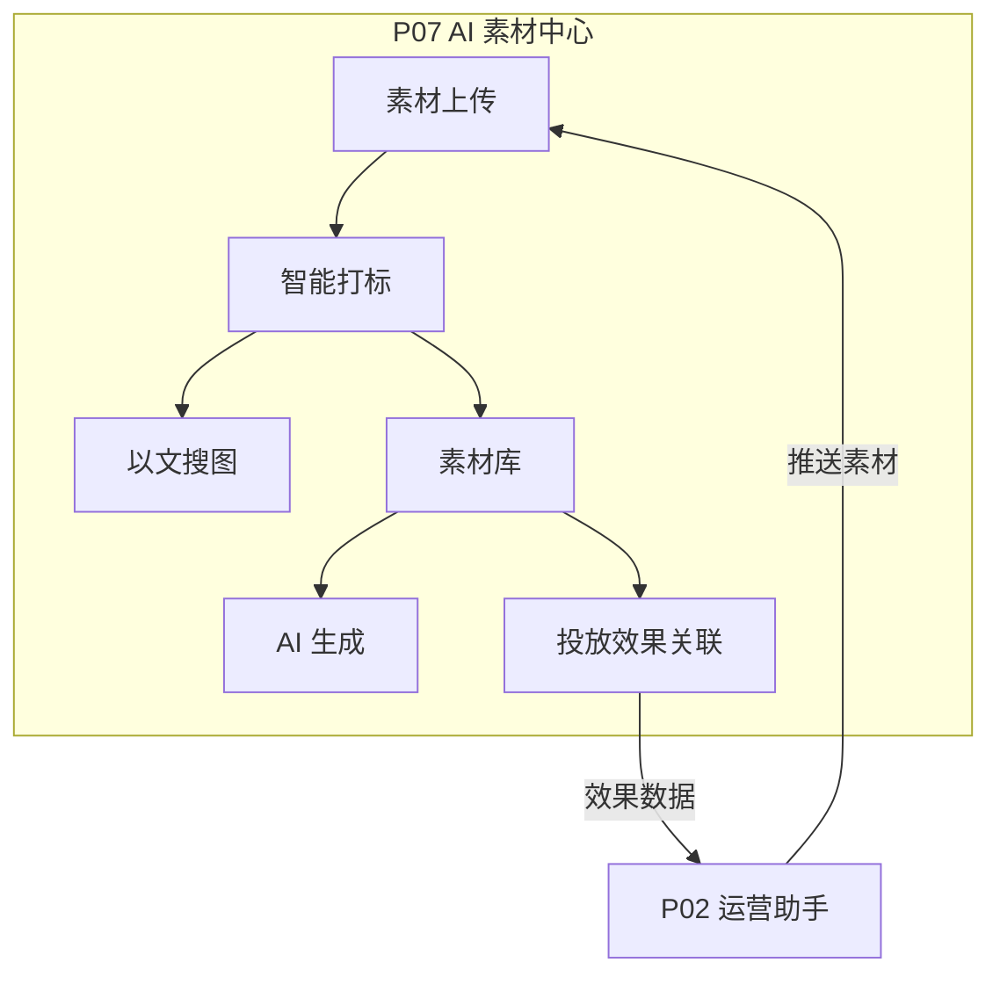

# P07 · AI 素材中心（CloudPivot 云枢智能）

## 定位
品牌电商 AI 素材生产、管理与检索中心，支撑投放素材全生命周期。

## 业务痛点
- 素材散落在多个平台，无法统一检索
- 设计师产出效率低，重复制作同类素材
- 投放效果与素材脱节，无法量化哪类素材转化好

## 架构图



## 技术栈
| 层 | 选型 | 理由 |
|---|---|---|
| 后端 | Python 3.11 + FastAPI + SQLite | 轻量、零外部依赖 |
| 前端 | 单页 HTML + Tailwind CDN + ECharts | 无构建步骤 |
| 搜索 | TF-IDF 文本匹配（模拟 CLIP） | 演示用途，标注 mock 边界 |
| 生成 | Mock（标注边界） | 无 GPU 环境下的降级方案 |

## 快速开始
```bash
cd projects/p06-data-platform  # 先起 P06
cd projects/p07-ai-asset-center
pip install fastapi uvicorn
python app/main.py
# 访问 http://127.0.0.1:8070
```

## API 清单
| 方法 | 路径 | 说明 |
|---|---|---|
| GET | `/api/v1/assets` | 素材列表（分页+筛选） |
| POST | `/api/v1/assets` | 上传素材 |
| GET | `/api/v1/assets/{id}` | 素材详情 |
| DELETE | `/api/v1/assets/{id}` | 删除素材 |
| POST | `/api/v1/search` | 以文搜图 |
| POST | `/api/v1/generate` | AI 生成素材（mock） |
| GET | `/api/v1/reports/performance` | 素材投放效果报表 |
| GET | `/api/v1/stats` | 素材统计概览 |
| GET | `/health` | 健康检查 |

## Mock 边界
- **以文搜图**：使用 TF-IDF 文本匹配模拟 CLIP 向量检索，非真实多模态
- **AI 生成**：返回预设模板，非真实图片/视频生成
- 以上均在 UI 和 README 双处标注

## 量化指标
- 素材检索响应 < 100ms
- 支持 1000+ 素材管理
- 投放效果关联覆盖率 > 80%
