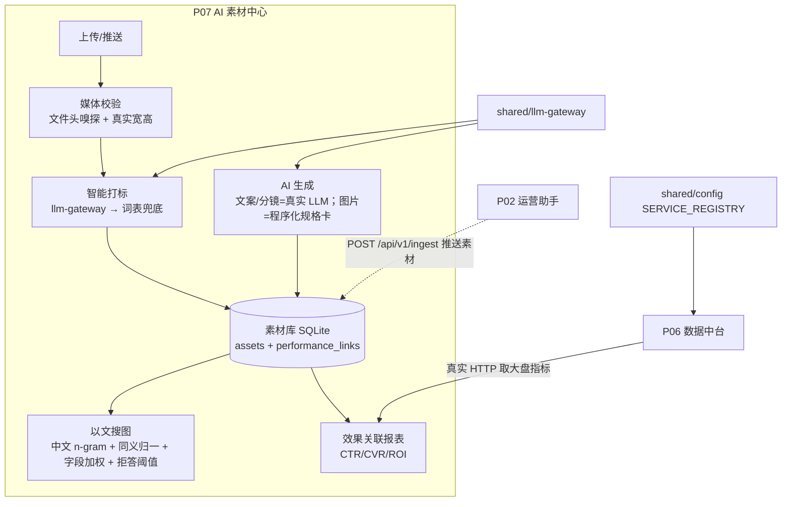

# P07 · AI 素材中心（云枢智能 CloudPivot）

## 一句话定位
品牌电商的 AI 素材生产-管理-检索中心：素材上传即自动打标，自然语言即可搜到素材，生成物直接入库，并与投放效果数据关联到同一张报表上。

## 业务痛点
- 素材散落在多个平台与设计师本地，**找图靠翻文件夹**，同类素材被反复重做；
- 素材标签靠人工随手写，**同一含义三种写法**（防晒/防晒霜/SPF50），检索召回极差；
- 投放跑完之后**说不清「哪张图带来转化」**，素材与 ROI 两张皮；
- 文案/主图产出后没有归口，**下一次投放又从零开始**。

## 架构图



## 技术栈与选型理由
| 层 | 选型 | 理由 |
|---|---|---|
| 后端 | Python 3.11 + FastAPI + Pydantic v2 | 与全平台一致；`api/services/repository/db` 分层，路由不写 SQL |
| 存储 | SQLite（WAL） | 单机演示零外部依赖；`data/assets.db`，旧库靠 `ALTER TABLE` 就地迁移，不要求删库重建 |
| 模型 | `shared/llm-gateway` | 统一凭证解析、主/备端点故障转移、token 与耗时统计；主用 Key 为空时自动落到备用端点 |
| Prompt | `prompts/*.md` 版本化 | 与代码分离，响应里回显 `prompt_version`，改 prompt 可追溯 |
| 检索 | 中文 n-gram + 同义组归一 + 字段加权 + IDF + 阈值拒答 | 纯本地零依赖；改造前的 `split()+子串包含` 在中文长句上 Recall@5 只有 0.05 |
| 图像 | Pillow | 上传读真实宽高；生成投放规格卡（明确标注非 AI 出图） |
| 跨模块 | `cloudpivot_config.api_url("p06", ...)` | 端口只从 SERVICE_REGISTRY 解析，禁止硬编码 |
| 前端 | 单页 HTML + Tailwind CDN + ECharts + `shared/ui-kit` | 无构建步骤；配色唯一真源是 `tokens.css`，主题切换后图表重画 |

## 快速开始
```bash
cd projects/p07-ai-asset-center
uv sync                      # Python 3.11；依赖见 pyproject.toml + uv.lock
uv run python app/main.py    # 端口从 SERVICE_REGISTRY 解析 → http://127.0.0.1:8070
```
或用平台进程托管（推荐，连同其它模块一起管）：
```bash
python _tools\supervisor.py restart p07
python _tools\supervisor.py status
```
统一入口 http://127.0.0.1:8800 → 能力层 → AI 素材中心。
模型凭证读仓库根 `.env`（`LLM_BASE_URL[_FALLBACK]` / `LLM_API_KEY[_FALLBACK]` / `LLM_MODEL[_FAST|_ALT]`）；
不配 Key 也能跑，只是打标与文案会退回规则兜底并在 UI 与响应里标注。

## API / 功能清单
16 个 HTTP 端点（13 条路径）：

| 方法 | 路径 | 说明 |
|---|---|---|
| GET | `/health` | 健康检查，附带模型是否已接入 |
| GET | `/api/v1/stats` | 素材总数、含预览文件数、类型/来源/打标来源分布、关联覆盖率、花费收入 ROI |
| GET | `/api/v1/assets` | 分页列表（`page/size/asset_type/keyword`），`tags` 出参恒为数组，带 `file_url` |
| POST | `/api/v1/assets` | multipart 上传：文件头嗅探 MIME、读真实宽高、`auto_tag=true` 直接智能打标 |
| GET | `/api/v1/assets/{id}` | 详情（含投放关联） |
| PATCH | `/api/v1/assets/{id}` | 改名/描述/标签/正文 |
| DELETE | `/api/v1/assets/{id}` | 删除素材 + 投放关联 + 磁盘文件 |
| GET | `/api/v1/assets/{id}/file` | **预览/下载真实文件**（图片、视频） |
| POST | `/api/v1/assets/{id}/tag` | 智能打标（覆盖或追加），返回 `tag_source`、耗时、token、降级原因 |
| POST | `/api/v1/assets/{id}/performance` | 录入投放数据（漏斗一致性校验：点击>曝光、转化>点击 → 422） |
| POST | `/api/v1/search` | 以文搜图，返回相关度、命中词与字段、`refused` 拒答标记 |
| POST | `/api/v1/generate` | 文案/视频分镜（真实 LLM）与投放规格图（程序化），`save_to_library` 直接入库 |
| GET | `/api/v1/reports/performance` | 素材×投放报表（CTR/CVR/ROI）+ **真实调用 P06 的大盘对照** |
| POST | `/api/v1/ingest` | 跨模块写入口（P02 推送素材），来源白名单 + 可选 `X-P07-Ingest-Token` |
| GET | `/api/v1/llm/status` | 模型接入状态与网关成本快照（调用数、tokens、mock 次数、延迟） |
| GET | `/` | 单页前端（概览/素材库/以文搜图/AI 生成/效果关联，支持 `#asset/ID`、`#search/<词>` 等深链） |

## 演示脚本（5 分钟）
1. **概览**（`#dashboard`）：4 张指标卡与 6 张图全部来自接口真实字段；右下角脚注写明演示数据边界。
2. **上传 + 自动打标**（`#library`）：填名称、拖一张 PNG、勾「上传后自动智能打标」→ 卡片立刻出现，
   尺寸是文件真实宽高，标签是 LLM 真实产出（`tag_source=llm`），顶部徽章的网关调用计数 +1。
3. **以文搜图**（`#search/夏天清爽的防晒霜`）：命中「防晒霜对比图」相关度 43%，并回显**哪个词命中哪个字段**；
   换成 `#search/库里没有的无人机航拍素材` → 明确拒答而不是硬凑结果。
4. **AI 生成**（`#generate`）：文案/分镜走真实模型（约 20-30 秒，页面有等待计时），结果一键入库；
   图片类型给的是程序化投放规格卡，页面与响应双处写明「非 AI 出图」。
5. **效果关联**（`#report`）：素材×平台×店铺的 CTR/CVR/ROI 明细，上方大盘对照区是**真实调用 P06** 的结果；
   把 P06 停掉再刷新，这里会显示不可用原因而不是编造数字。
6. **降级**：把 `.env` 里两组凭证清空后重启 → 徽章变「模型降级 · 规则兜底」，打标退回词表、文案退回模板，功能不中断且处处标注。

## 量化指标（全部为实测，含测量条件）
| 指标 | 数值 | 条件 |
|---|---|---|
| 检索 Recall@5 / Precision@1 / MRR | 1.0 / 1.0 / 1.0 | 26 条人工标注查询、12 条语料、本机进程内（`eval/search_eval.py`） |
| 检索拒答准确率 | 1.0（6/6 条无匹配查询） | 同上 |
| 改造前同集 Recall@5 | **0.05**（19/20 条未命中） | 同一评测集跑 `split()+子串包含` |
| 检索延迟 | 平均 0.78 ms / P95 0.87 ms | 12 条语料、单机无并发，**不代表生产吞吐** |
| 打标概念覆盖率 | LLM 0.97 / 词表规则 0.879 | 12 条素材、人工标注概念集（`eval/tagging_eval.py`） |
| 打标成本与时延 | 12 次真实调用、7963 tokens、0 次 mock、平均 7.4 s/次（qwen3.8-flash） | token-plan 端点实测 |
| 文案生成时延 | 实测 18.6–30.0 s/次 | 同上，网关超时上限 75 s |
| 测试 | 68 passed（改造前 18） | `pytest tests -v`，模型与 P06 均打桩，测试进程不发真实请求 |
| 当前库内投放关联覆盖率 | 8/14 = 57% | 真实接口返回，非目标值 |

## 已知限制与 mock 边界
- **图片不是 AI 生成的**：`generate` 的 image 分支是 Pillow 绘制的投放规格卡（800×800 等），
  用于把「生成→落库→预览→检索」跑成真闭环；接口 `note`、页面横幅、本文件三处标注。
  端点 `/models` 里确有 `wan2.7-image`、`wan3.0-video`，但其调用接口形状（DashScope 异步任务 vs OpenAI 兼容）
  在本环境**未验证**，未验证不宣称已跑通。
- **以文搜图是文本层检索**，不是 CLIP 多模态向量检索；响应体 `engine` 字段写明。真实向量方案未落地：
  `EMBEDDING_MODEL` 在 token-plan 端点实测 404。
- **12 条 demo 素材及其图片是程序化演示数据**（`source=demo`），不是真实商品素材。
- **P02 侧「一键推送到素材中心」尚未接线**：P07 的 `POST /api/v1/ingest` 已就绪并有测试覆盖，
  P02 的推送按钮仍是 P02 自己 `AGENTS.md` 里未勾选的待办。
- **未接入统一鉴权**：读接口匿名可访问，写接口仅 `/ingest` 有来源白名单与可选令牌；与 P06/P08/P09/P10 一致，属平台级待办。
- **未做**：并发压测、真实素材量级下的检索性能、生成文案的投放效果增益回流、Docker 化（当前单机 uv 直跑）。
- 前端样式使用 Tailwind CDN（与全平台静态模块一致），控制台会有一条 production 提示。

## 面试问答 10 条
1. **为什么不用 CLIP？** 演示机只有单卡 4060 且当前可用端点不提供 embeddings（实测 404）。我用「中文 n-gram + 同义组归一 + 字段加权」把 Recall@5 从 0.05 提到 1.0，同时把「这不是多模态向量检索」写在响应体和页面上 —— 能力边界比好看的说法重要。
2. **检索怎么做到可解释？** 每个命中返回 `matched_terms`（哪个词命中 tags/name/description），前端直接展示；相关度是 IDF 加权后按查询侧总权重归一，配 0.18 的阈值做拒答。
3. **中文分词为什么用二元组而不是 jieba？** 零依赖、对未登录词（"以旧换新"）鲁棒，且二元组天然覆盖子串匹配；代价是切出"有没/用的"这类噪声词，靠 IDF 把它们的权重压下去。
4. **没有 Key 时系统会怎样？** `llm_endpoint()` 返回 None → 打标退回 `_LEXICON` 词表、文案退回模板，响应带 `tag_source=rule` 和 `degraded_reason`，UI 徽章从「LLM 已接入」变「模型降级」。功能不断，但绝不冒充模型产出。
5. **凭证为什么不用主端点？** 根 `.env` 里 `LLM_API_KEY` 为空、`LLM_API_KEY_FALLBACK` 有值，而百炼 sk-/sk-sp- 只认自己的端点，所以解析器按「第一个凭证齐全的端点」选，并把实际用的端点回显在 `/llm/status` 里。
6. **上传的文件安全吗？** 客户端 Content-Type 一律不信，按文件头嗅探；不在白名单（png/jpeg/webp/gif/mp4/mov/webm）直接 422；落盘文件名用服务端生成的 asset_id，且校验路径不越出 `uploads/`；上限 32MB。
7. **为什么 `tags` 要在读侧规范化成数组？** 历史上标签以原始字符串入库，前端 `JSON.parse("护肤,夏季")` 抛错导致整块素材库空白。现在 repository 统一 `normalize_tags`，接口对外只有数组，前端 `tagsOf()` 再兜一层。
8. **旧库怎么迁移？** 启动时 `PRAGMA table_info` 检查缺列就 `ALTER TABLE ADD COLUMN`（`mime_type/tag_source/content`），并把早期被写死成同一时刻的 demo `created_at` 摊开 —— 不要求删库重建，用户数据不动。
9. **跨模块调用怎么保证不硬编码端口？** 全部经 `cloudpivot_config.api_url("p06", "/metrics/summary")` 解析 SERVICE_REGISTRY；P06 不在时报表返回 `available=false` + 原因，前端显示"不编造大盘数字"。
10. **下一步做什么？** ① 验证 `wan2.7-image` 的异步任务接口，把图片生成分成「真实出图」与「规格卡」两条明确路径；② 接 embeddings 端点后把检索升级为向量 + 关键词混合召回并做 A/B；③ 在 P02 侧接上 `ingest` 推送，把「生成→归库→投放→回流」闭环跑通。
