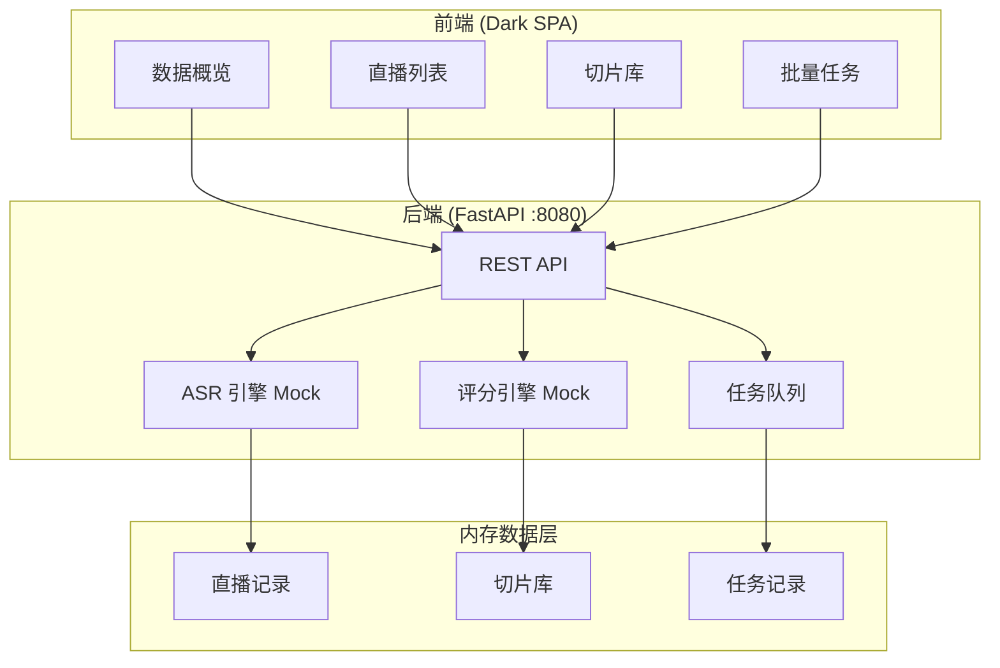

# P08 直播切片系统

> **一句话定位**：自动从直播录像中提取高光片段，通过模拟 ASR 转写 + 多维评分算法，为电商运营提供可复用的短视频素材。

## 业务痛点

1. 直播时长 2-6 小时，运营人工找精彩片段耗时且遗漏多
2. 高光判断主观，缺乏量化标准，不同运营标准不统一
3. 批量直播切片效率低，无法规模化产出短视频素材

## 架构



## 技术栈

| 层 | 选型 | 理由 |
|---|---|---|
| 后端 | FastAPI + Pydantic v2 | 异步高性能，自动 OpenAPI 文档 |
| 前端 | 单文件 HTML + Vanilla JS | 零构建，深色主题，响应式 |
| 数据 | 内存字典 + 预置种子数据 | 演示用途，无需外部数据库 |
| 包管理 | uv + pyproject.toml | 符合项目规范 |

## 快速开始

```bash
# 1. 进入项目目录
cd projects/p08-live-clip

# 2. 安装依赖
uv sync

# 3. 启动服务
python app/main.py

# 4. 打开浏览器
# http://127.0.0.1:8080
```

## API 清单

| 方法 | 路径 | 说明 |
|---|---|---|
| GET | `/health` | 健康检查，返回 mock 边界声明 |
| GET | `/api/v1/streams` | 直播列表，支持 platform/status 筛选 |
| GET | `/api/v1/streams/{id}` | 直播详情，含 ASR 转写全文 |
| GET | `/api/v1/clips` | 切片库，分页 + 排序 + 标签/场次/分数筛选 |
| GET | `/api/v1/clips/{id}` | 切片详情，含四维评分明细与解释 |
| POST | `/api/v1/process` | 提交批量切片任务 |
| GET | `/api/v1/tasks` | 任务队列列表 |
| GET | `/api/v1/tasks/{id}` | 单个任务详情 |
| GET | `/api/v1/stats` | 概览统计：切片数/均分/热词等 |

## Mock 边界（重要）

本系统为**演示用途**，以下功能均为模拟实现：

| 模块 | 实际实现 | 生产环境应替换为 |
|---|---|---|
| **ASR 转写** | 预置脚本文本 + 时间戳 | 阿里云 / 讯飞 / Whisper 语音识别 |
| **高光评分** | 基于关键词密度 + 能量 + 语速的规则算法 | 多模态 ML 模型（视觉+音频+NLP） |
| **视频处理** | 无实际操作 | FFmpeg 切片 + 转码 + 封面截取 |
| **数据存储** | 内存字典 | PostgreSQL + Redis + 对象存储 |

UI 与 README 中均已标注 `[模拟数据]` 徽章。

## 演示脚本

1. **打开首页** -> 展示数据概览：3 场直播、切片总数、平均评分、热门关键词
2. **直播列表** -> 点击任一直播 -> 查看 ASR 转写结果（标注为模拟）
3. **切片库** -> 瀑布流展示所有切片 -> 按评分排序 -> 点击切片查看四维评分明细
4. **评分解释** -> 每个切片展示"为什么分高"：命中关键词、互动热度、能量峰值
5. **批量任务** -> 新建任务 -> 选择直播 -> 提交 -> 查看任务进度
6. **Mock 边界** -> 侧边栏底部 + 各 ASR/评分区域均有模拟标识

## 预置样例数据

| 直播 | 平台 | 主播 | 时长 | 主题 |
|---|---|---|---|---|
| 春季美妆新品发布会 | 抖音 | 小美老师 | 6 分钟 | 美妆护肤 |
| 深夜食堂 - 招牌菜专场 | 快手 | 美食老王 | 5.5 分钟 | 美食 |
| 2024春夏新品预览 | 淘宝直播 | 时尚Coco | 6.7 分钟 | 服装 |

每场直播包含 10+ 条 ASR 转写段落和若干自动提取的评分切片。

## 评分算法说明

四维加权评分（满分 100）：

- **关键词密度** (30%)：命中业务关键词（产品名、促销词、互动词）
- **能量峰值** (20%)：模拟主播音量/情绪高涨片段
- **语速变化** (20%)：模拟语速节奏变化（加速=兴奋、减速=重点）
- **互动热度** (30%)：弹幕互动、引导下单、抽奖等场景

## 已知限制

- 无真实视频处理能力，不支持上传实际视频文件
- ASR 数据为预置脚本，非实时语音识别
- 评分算法为规则引擎，无机器学习能力
- 数据存储在内存中，重启后恢复为种子数据
