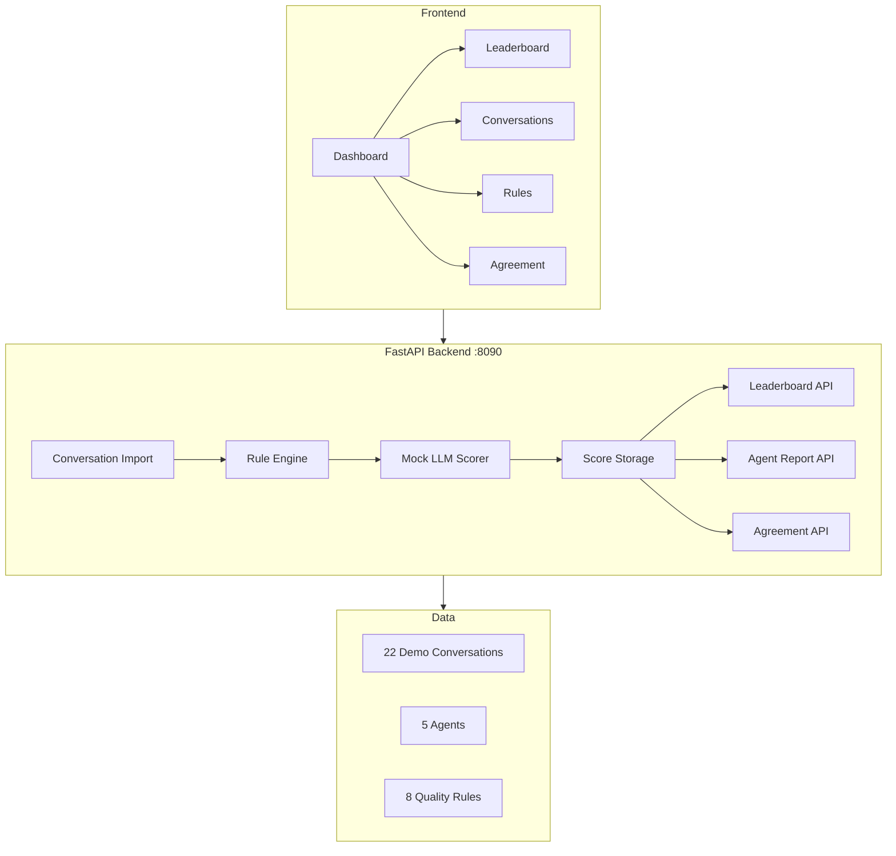

# P09 AI Sales Assessment (AI 销售考核)

## 一句话定位

AI 驱动的客服/销售会话质检与绩效考核系统，自动对会话进行多维度评分、排名、生成个人报告，并计算人机一致性。

## 业务痛点

- 传统质检依赖人工抽检，覆盖率不足 5%，主观性强
- 客服绩效评估缺乏量化指标，无法精准定位能力短板
- 评分标准不统一，不同质检员对同一会话打分差异大
- 无法实时反馈，客服无法及时改进

## 架构图



## 技术栈

| 层 | 技术 | 选型理由 |
|---|---|---|
| 后端 | FastAPI + Pydantic v2 | 异步高性能，自动 OpenAPI 文档 |
| 前端 | 单 HTML + ECharts | 零构建，暗色主题，图表丰富 |
| 评分引擎 | 规则引擎 (Mock LLM) | 基于关键词与启发式规则的多维度评分 |
| 一致性分析 | Cohen's Kappa | 衡量人机评分一致性，排除随机因素 |

## 快速开始

```bash
cd D:\software\PycharmProjects\面试项目\projects\p09-ai-sales-assessment

# 安装依赖
uv sync

# 启动
uv run python app/main.py

# 访问
# http://localhost:8090
```

## 评分维度

| 维度 | 权重 | 说明 |
|---|---|---|
| 服务态度 | 25% | 问候语、共情表达、结束语、禁用词 |
| 专业度 | 25% | 回复详细度、主动核查、对话深度 |
| 需求挖掘 | 15% | 多轮对话、探索额外需求 |
| 促成转化 | 20% | 升单/连带推荐、强化购买决策 |
| 合规性 | 15% | 竞品提及、不实承诺 |

## API 清单

| 方法 | 路径 | 说明 |
|---|---|---|
| GET | `/health` | 健康检查 |
| GET | `/api/v1/stats` | 总览统计 |
| GET | `/api/v1/leaderboard` | 客服排名 |
| GET | `/api/v1/agents/{id}` | 个人报告（雷达图+趋势+建议） |
| GET | `/api/v1/conversations` | 会话列表（支持分页+筛选） |
| GET | `/api/v1/conversations/{id}` | 会话详情（消息+评分明细） |
| POST | `/api/v1/evaluate` | 实时评估新会话 |
| GET | `/api/v1/rules` | 质检规则列表 |
| PUT | `/api/v1/rules/{id}` | 更新规则（启用/禁用/调整扣分） |
| GET | `/api/v1/agreement` | 人机一致性（Kappa + 混淆矩阵 + 口径与局限）；真人评分不足 5 条时返回 `kappa: null` |
| GET | `/api/v1/labeling` | 人工标注进度（已评/待评/评分者/时间范围/权重） |
| GET | `/api/v1/labeling/queue` | **盲评队列**（不含任何 AI 分数） |
| POST | `/api/v1/labeling/{id}` | 提交真人五维评分 → 按权重算综合分并落盘，返回揭示后的 AI 分与差值 |
| DELETE | `/api/v1/labeling/{id}` | 撤销某条真人评分 |
| GET | `/label.html` | 人工质检评分台页面 |
| POST | `/api/v1/import` | 导入 CSV/JSON 会话数据 |
| GET | `/api/v1/p01/status` | 探测 P01 客服在线状态（跨模块数据来源标注） |
| POST | `/api/v1/import/from-p01` | **跨模块真实调用** P01 `GET /api/chat/history` 拉取真实会话并自动评分 |

## Mock 边界

| 功能 | Mock 说明 | 标注位置 |
|---|---|---|
| LLM 评分 | 基于关键词和启发式规则打分，非真实 LLM 调用 | 前端 Dashboard 顶部 + README |
| 人工评分（一致性用） | **必须是真人逐条盲评出来的分**，落在 `data/human_labels.json`。早期版本用「AI 分 + `random.uniform(-12,12)` 噪声」冒充人工分算 Kappa —— 那是让 AI 和自己比，已删除；现在没有真人评分时 `/api/v1/agreement` 直接返回 `kappa: null` 不出数 | 评分台 + 一致性页顶部 + 接口 `provenance` |
| 会话数据 | 默认 22 条为程序生成的演示会话（非真实业务数据）；`/api/v1/import/from-p01` 拉取的则是 P01 的**真实会话**。一致性报告会按 `provenance.conversation_source` 分开计数，被评会话若全是演示预置，会在 `limitations` 里明说 | README + 前端说明 |
| P01 跨模块调用 | 真实 HTTP 调用（地址从 SERVICE_REGISTRY 解析）；P01 不可达时降级返回 `degraded=true, imported=0`，**不伪造会话** | 接口响应 + README |

## 人工质检评分台（出真 Kappa 的地方）

```
浏览器打开  http://127.0.0.1:8090/label.html
```

- **盲评**：队列与单条视图都不含任何 AI 分数（接口层面就不返回），提交后才揭示 AI 分与差值，避免锚定；
- **同口径**：人工分同样按五维加权 —— 服务态度 25% / 专业度 25% / 需求挖掘 15% / 促成转化 20% / 合规性 15%，
  与 `_rule_based_score()` 用的是同一套权重，否则两边分数不可比；
- **落盘**：`data/human_labels.json`（含维度分、综合分、评语、评分者、UTC 时间），重启后自动回填到会话，
  一致性报告不丢；
- **最小样本**：真人评满 5 条才出报告（`MIN_LABELS_FOR_AGREEMENT`），小样本 Kappa 置信区间过宽，不出数比出错好；
- 相关接口：`GET /api/v1/labeling`（进度）、`GET /api/v1/labeling/queue`、`GET/POST/DELETE /api/v1/labeling/{id}`。

## 演示数据

- **5 名坐席**: 张伟（优秀）、李娜（良好）、王芳（一般）、陈杰（较差）、刘洋（良好）
- **22 条会话**: 涵盖产品咨询、退换货、投诉、促销等场景（程序生成的演示会话）
- **8 条质检规则**: 禁用词、必选话术、响应时间、语气、合规
- **人工评分**: 无预置值，需真人在评分台逐条盲评后才有

## 量化指标

- 评分维度: 5 维（服务态度/专业度/需求挖掘/促成转化/合规性）
- 规则数量: 8 条可配置规则
- 评分速度: <10ms/会话（规则引擎，本机进程内测得）
- 人机一致性: **当前未出具** —— 需真人评满 5 条；出具时报告自带评分者、时间范围、会话来源与局限说明
  （**不预设"应该是 Moderate-Substantial"这类期望值**）

## 已知限制

1. 评分引擎为规则匹配，不具备语义理解能力
2. 无法处理非中英文会话
3. **人机一致性报告尚未出具**：真人盲评尚未开始（`labeled_count=0`），
   且即便评完，也是**单人评分**，没有第二位评分者做 inter-rater 校验，Kappa 只反映"该评分者 vs 规则引擎"
4. 不支持实时流式评分
5. 无持久化存储，重启后数据重置（**例外**：真人评分落盘在 `data/human_labels.json`，重启后自动回填）
6. 被评会话目前多为演示预置数据；要拿真实业务会话做一致性验证，需先 `POST /api/v1/import/from-p01`

## 面试问答

1. **Q: 为什么用规则引擎而不是真实 LLM？** A: 面试演示环境无稳定 LLM 接口，规则引擎确保评分可复现、可解释。生产环境可替换为 LLM 评分，接口不变。
2. **Q: Kappa 系数是什么？** A: Cohen's Kappa 衡量两人评分一致性，排除随机一致。>0.6 为「高度一致」，>0.8 为「近乎完全一致」。
3. **Q: 评分维度怎么确定的？** A: 参考电商客服质检行业标准，5 维度覆盖服务态度、业务能力、销售转化、合规风险。
4. **Q: 如何扩展到真实 LLM 评分？** A: 替换 `_rule_based_score()` 为 LLM 调用，输入会话文本，输出结构化 JSON 评分。接口层无需修改。
5. **Q: 为什么陈杰分数最低？** A: 设定为较差质量坐席：使用禁用词、缺少共情、无结束语、响应慢，用于演示低分场景。
6. **Q: 如何导入真实数据？** A: POST `/api/v1/import` 支持 CSV 和 JSON 格式，CSV 需包含 role/content/timestamp 列。
7. **Q: 规则可以动态调整吗？** A: 可以，PUT `/api/v1/rules/{id}` 支持启用/禁用、调整扣分值。
8. **Q: 如何衡量 AI 评分可靠性？** A: 让真人做**盲评**（评分时接口不返回 AI 分，避免锚定），人工分沿用与规则引擎
   **同一套五维权重**，再算 Cohen's Kappa + 混淆矩阵 + Pearson。三点关键设计：① 样本不足 5 条直接不出数 ——
   小样本 Kappa 置信区间宽到没有意义；② 报告里必须带 `provenance`（评分者、时间范围、被评会话是真实导入还是演示预置）
   和 `limitations`（单人评分、没有第二位评分者做 inter-rater 校验、四档切分阈值本身会影响结果）；
   ③ 本项目**早期版本用「AI 分 + 随机噪声」冒充人工分**，那等于让 AI 和自己比，Kappa 必然虚高 ——
   这条是我主动删掉的，因为一个看起来漂亮但来源假的指标，比没有指标更危险。
9. **Q: 前端为什么用单 HTML？** A: 零构建部署，适合演示。生产环境可拆分为 Next.js 模块。
10. **Q: 与 P01 客服模块的关系？** A: P09 通过 `POST /api/v1/import/from-p01` **真实 HTTP 调用** P01 的 `GET /api/chat/history?sender_id=xxx`，按 session 聚合会话、把 P01 的 user/bot 角色映射为 P09 的 customer/agent，再走规则引擎评分——落实「P01 会话 → P09 质检」数据流闭环。目标地址由 `cloudpivot_config.api_url("p01", "/chat/history")` 从 `shared/config/services.json` 解析，**未硬编码端口**；P01 不可达时降级返回 `degraded=true, imported=0`，不伪造会话。验证证据见 `_evidence/p09-ai-sales-assessment/cross-module-p01-*.md`。
