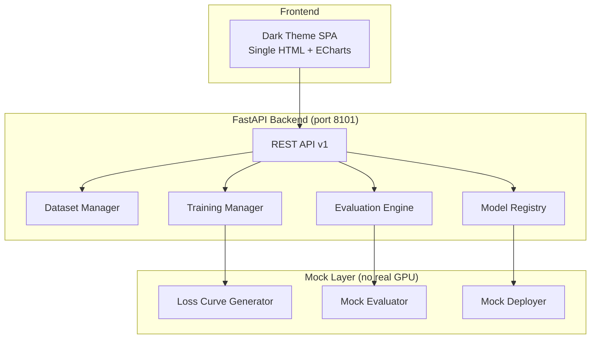

# P10 Model Finetune Platform

> CloudPivot AI - Model fine-tuning management platform

## Positioning

Centralized platform for managing the full lifecycle of model fine-tuning: dataset preparation, LoRA/QLoRA training configuration, evaluation with multiple metrics, model versioning, and deployment registration. Part of the CloudPivot (L1 Model Layer) architecture.

## Business Pain Points

- Fine-tuning workflows are scattered across scripts, notebooks, and ad-hoc tools
- No unified view of dataset quality, training history, and model performance
- Difficult to compare before/after fine-tuning results systematically
- Model versions lack traceability back to training configs and datasets

## Architecture



## Tech Stack

| Component | Choice | Rationale |
|-----------|--------|-----------|
| Backend | FastAPI + Pydantic v2 | Async, auto-docs, type-safe |
| Frontend | Single HTML + ECharts | Zero build step, dark theme |
| Data Store | In-memory dict | Mock mode, no DB dependency |
| Charts | ECharts 5 | Industry standard, dark theme support |
| Package Mgmt | uv + pyproject.toml | Per project standards |

## Quick Start

```bash
cd projects/p10-model-finetune

# Install dependencies
uv sync

# Start server
python app/main.py

# Open browser
# http://127.0.0.1:8101
```

## API Reference

| Method | Endpoint | Description |
|--------|----------|-------------|
| GET | `/health` | Health check |
| GET | `/api/v1/stats` | Dashboard overview stats |
| GET | `/api/v1/datasets` | List all datasets |
| POST | `/api/v1/datasets` | Upload new dataset |
| GET | `/api/v1/datasets/{id}` | Dataset detail with stats |
| POST | `/api/v1/training/start` | Start training (mock) |
| GET | `/api/v1/training/{id}` | Training run detail |
| GET | `/api/v1/training/{id}/loss` | Loss curve data points |
| GET | `/api/v1/evaluations` | List all evaluations |
| POST | `/api/v1/evaluations/compare` | Before/after comparison |
| GET | `/api/v1/models` | Model registry list |
| GET | `/api/v1/models/{id}` | Model detail |
| POST | `/api/v1/models/{id}/deploy` | Deploy model (mock) |

## Sample Data

- **3 demo datasets**: customer-service-qa, product-description, intent-classification
- **2 training runs**: LoRA run on CS-QA, QLoRA run on product descriptions, each with full loss curves
- **3 model versions**: CS-QA v1.0 (deployed), CS-QA v1.1 (registered), Product-Desc v1.0 (registered)
- **3 evaluations**: baseline (base model) + 2 post-fine-tuning evaluations

## Mock Boundaries

| Component | Mock Behavior | Real Behavior |
|-----------|--------------|---------------|
| **Training** | Simulated loss curves with exponential decay + noise. No GPU, no real model training. | Would use transformers + PEFT for actual LoRA/QLoRA training |
| **Evaluation** | Rule-based mock scores derived from training loss. No real model inference. | Would run model on eval set and compute BLEU/ROUGE/LLM-as-Judge |
| **Deployment** | Registers endpoint URL in memory. No real model serving. | Would use vLLM/TGI to serve OpenAI-compatible endpoint |

All mock boundaries are labeled in the UI (yellow banner) and this README.

## Known Limitations

- No persistent storage (all data resets on restart)
- Loss curves are procedurally generated, not from real training
- Evaluation scores are mock, not from real model inference
- No authentication/authorization (single-user mock mode)
- File upload generates random stats, does not parse actual file content

## Interview Q&A

1. **Q: Why FastAPI over Flask?** A: Async support, automatic OpenAPI docs, Pydantic v2 integration for type-safe request/response validation.

2. **Q: How does the loss curve simulation work?** A: Exponential decay `base_loss * exp(-k * progress)` plus Gaussian noise, with cosine annealing for learning rate schedule.

3. **Q: What metrics does evaluation track?** A: Accuracy, format compliance, LLM-as-Judge score (1-5), average response quality, BLEU, ROUGE-L, hallucination rate.

4. **Q: How would you extend this for real training?** A: Replace the mock training function with a Celery/async task that calls `transformers.Trainer` with PEFT config. Loss curve would come from actual training logs.

5. **Q: Why single HTML file for frontend?** A: Zero build step, instant deployment, no Node.js dependency. For production, would split into Vite+React components.

6. **Q: How does before/after comparison work?** A: Compares evaluation metrics between base model baseline and fine-tuned model. Delta shows improvement per metric.

7. **Q: What LoRA parameters are configurable?** A: Rank, alpha, target modules, learning rate, epochs, batch size, gradient accumulation, max sequence length, warmup ratio, weight decay.

8. **Q: How would you handle multi-GPU training?** A: Add distributed config (DeepSpeed/FSDP) to training config, use Ray/Celery for job scheduling, stream logs via WebSocket.

9. **Q: What's the model registry design?** A: Each version tracks: base model, training ID (lineage), config snapshot, metrics, deployment status, endpoint URL. Supports registered/deployed/archived states.

10. **Q: How does this integrate with the broader CloudPivot platform?** A: Fine-tuned models serve P01 (customer service) and P02 (ops assistant) via OpenAI-compatible endpoints. Evaluation data feeds back into P09 (sales assessment) for quality tracking.
